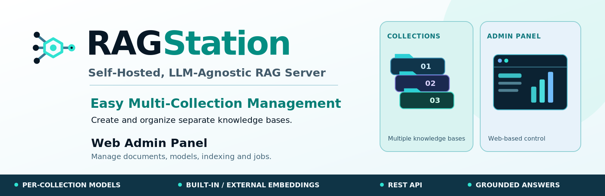
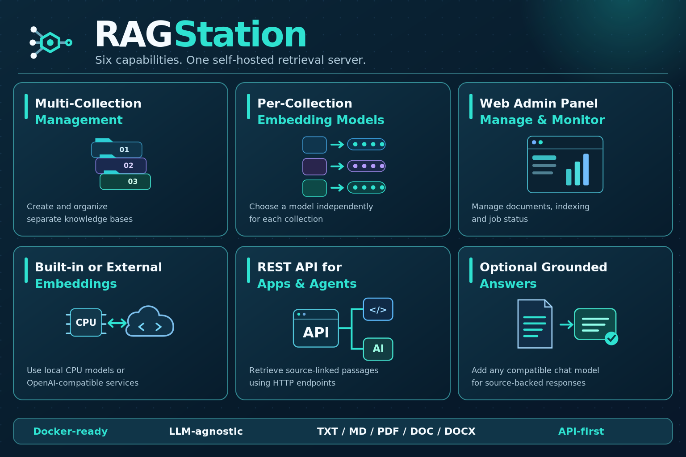

<p align="center">
  <picture>
    <source media="(prefers-color-scheme: dark)" srcset="assets/brand/github-readme-banner.png">
    
  </picture>
</p>

# RAGStation

An LLM-agnostic retrieval server that finds the evidence in your documents. Run it on your own computer or server and point it at a folder of documents (TXT, MD, PDF, DOC, DOCX); it indexes them, and your application, script or AI assistant asks it for the passages most relevant to a question. You choose the language model; RAGStation can also generate grounded answers with any OpenAI-compatible chat API, but that is optional.

Who it is for:

- **Developers** building a chatbot or internal tool who want retrieval over their own documents.
- **People connecting documents to an AI assistant or agent.**
- **Learners** who want a small, readable reference implementation of retrieval-augmented generation (RAG).



The guide below goes from the quickest start to the more advanced setups. Stop at the level you need.

- [Level 1 — Try it in 5 minutes](#level-1--try-it-in-5-minutes)
- [Level 2 — Search your own documents](#level-2--search-your-own-documents)
- [Level 3 — Use it from your app](#level-3--use-it-from-your-app)
- [Level 4 — Get written answers (optional)](#level-4--get-written-answers-optional)
- [Level 5 — Choose the embedding model](#level-5--choose-the-embedding-model)
- [Level 6 — Protect the admin panel](#level-6--protect-the-admin-panel)
- [Level 7 — How it works and developing locally](#level-7--how-it-works-and-developing-locally)
- [Troubleshooting](#troubleshooting) · [Reference](#reference)

## Level 1 — Try it in 5 minutes

**Requirement: Docker.** Nothing else is needed: no Node.js, no Python, no separate database.

- Windows / macOS: install [Docker Desktop](https://www.docker.com/products/docker-desktop/) and start it. Wait until it shows that the engine is running; Docker commands fail while Docker Desktop is closed. On Windows, the installer also sets up WSL 2; accept it (a restart may be needed).
- On Windows, pick the **AMD64** installer (also for Intel processors) unless your PC has an ARM processor; `$env:PROCESSOR_ARCHITECTURE` in PowerShell tells you which. Docker Desktop also needs hardware virtualization turned on in the BIOS/UEFI (Task Manager → Performance → CPU shows "Virtualization: Enabled").
- Linux: install [Docker Engine](https://docs.docker.com/engine/install/) with the Compose plugin.

Check it in a terminal: `docker --version` and `docker compose version` must both print a version.

macOS / Linux (Terminal):

```bash
mkdir ragstation && cd ragstation
curl -O https://raw.githubusercontent.com/kmkarakaya/ragstation/main/docker-compose.yml
docker compose up -d
```

Windows (PowerShell):

```powershell
mkdir ragstation; cd ragstation
curl.exe -O https://raw.githubusercontent.com/kmkarakaya/ragstation/main/docker-compose.yml
docker compose up -d
```

In Windows PowerShell, `curl` (without `.exe`) is a different command and `&&` does not work, so use the PowerShell block as written.

1. Open `http://localhost:3010/admin`. A collection called **Sample documents** is created and indexed on the first start. The first indexing downloads the built-in embedding model (about 350 MB, once), so it can take a few minutes; the **Job Monitor** shows the progress.
2. When the collection is `ready`, open it, go to the **Playground** tab, type `What is a chunk?` and click **Retrieve**.
3. You get the passages (chunks) closest in meaning to your question, each with its source file and a distance: the smaller the distance, the closer the match. This is retrieval, the core of RAG. The sample documents explain the rest of the concepts.

Good to know:

- Everything lives next to `docker-compose.yml`: your uploaded documents (`./data/collections`) and the registry in `./data`, the vectors in `./chroma_data`, the downloaded model in `./models`. `docker compose down` stops the stack and keeps all of it; `docker compose up -d` starts it again in seconds.
- Port already in use? Create a `.env` file next to `docker-compose.yml` with `BACKEND_HOST_PORT=3020` (and/or `CHROMA_HOST_PORT=8020`) and open that port instead. The startup log still prints `localhost:3010`, its port inside the container.
- Prefer the source code? `git clone https://github.com/kmkarakaya/ragstation.git`, `cd ragstation`, `docker compose up -d`. The clone also contains `data/dataset1` and `data/dataset2`, two small Turkish sample folders. `docker compose up -d --build` builds the image from your working copy.
- Don't want the sample collection? Delete it in the admin panel (it is not recreated), or put `RAG_SAMPLE_COLLECTION=false` in `.env` before the first start.

## Level 2 — Search your own documents

Each collection you create gets its own folder for documents. You add documents in the admin panel or over the API; you never type a path. Supported: `.txt`, `.md`, `.pdf` (with a text layer), `.doc`, `.docx`.

**In the admin panel:**

1. Go to **Collections** → **New Collection**, enter a display name (keep **Upload files** selected) and click **Save Changes**.
2. The **Documents** tab opens. Drop your files there, or click it to choose them. A file with the same name as an existing one replaces it.
3. Click **Re-index now** and wait until the job is `succeeded` in the **Job Monitor**. If it fails, the error is shown there.
4. Use the **Playground** tab to search.

After you upload documents, the Documents tab asks you to re-index again. Re-indexing builds a new index in the background, and searches keep using the old one until it is ready. A deleted document leaves the search results right away; no re-index is needed.

**The same over the API** (the admin panel uses exactly these endpoints):

```bash
# 1. Create a collection; the response contains its id
curl -X POST http://localhost:3010/v1/admin/collections \
  -H "content-type: application/json" -d '{"displayName": "My docs"}'

# 2. Upload documents (one -F per file, up to 20 per request)
curl -F "files=@handbook.pdf" -F "files=@notes.md" \
  http://localhost:3010/v1/admin/collections/<collection-id>/files

# 3. Index them; the response contains the job id. Repeat the second call until "status" is "succeeded"
curl -X POST http://localhost:3010/v1/admin/collections/<collection-id>/reindex
curl http://localhost:3010/v1/admin/jobs/<job-id>

# 4. Search
curl -X POST http://localhost:3010/v1/rag/collections/<collection-id>/retrieve \
  -H "content-type: application/json" -d '{"question": "What is in the handbook?"}'
```

Windows PowerShell (uploads use `curl.exe`, because Windows PowerShell 5.1 cannot send files with `Invoke-RestMethod`):

```powershell
$base = "http://localhost:3010"
$id = (Invoke-RestMethod -Method Post -Uri "$base/v1/admin/collections" -ContentType "application/json" -Body '{"displayName": "My docs"}').collection.id
curl.exe -F "files=@handbook.pdf" -F "files=@notes.md" "$base/v1/admin/collections/$id/files"
$jobId = (Invoke-RestMethod -Method Post -Uri "$base/v1/admin/collections/$id/reindex").job.id
(Invoke-RestMethod "$base/v1/admin/jobs/$jobId").job.status
Invoke-RestMethod -Method Post -Uri "$base/v1/rag/collections/$id/retrieve" -ContentType "application/json" -Body '{"question": "What is in the handbook?"}' | ConvertTo-Json -Depth 5
```

List the documents with `GET /v1/admin/collections/<collection-id>/files` and delete one with `DELETE /v1/admin/collections/<collection-id>/files/<file-name>` (URL-encode names with spaces); a deleted document is removed from the index at once. Deleting the collection deletes its documents too. Files are limited to 50 MB each (`uploads.maxFileSizeMb`). With [admin auth](#level-6--protect-the-admin-panel) turned on, these admin calls also need a session cookie and an action token; see [docs/http_workflows.md](docs/http_workflows.md).

**Advanced: index a folder on the server.** If your documents already live on the server, put them in a folder inside `./data` (next to `docker-compose.yml`; in a clone, the repo's `data` folder), for example `./data/handbook`. Then choose **Use a folder on the server** in New Collection, or send `"sourcePath": "data/handbook"` when you create it over the API. With Docker, a path on your computer such as `C:\docs` does not work: the server only sees its `data` folder. Such a collection reads that folder directly; the Documents tab lists its files but cannot change them, so you manage the files there and re-index.

## Level 3 — Use it from your app

Everything the Playground does is available over HTTP. List the collections to get their ids:

```bash
curl http://localhost:3010/v1/rag/collections
```

Retrieve passages for a question (`k` is optional; the collection's default is 5):

```bash
curl -X POST http://localhost:3010/v1/rag/collections/<collection-id>/retrieve \
  -H "content-type: application/json" \
  -d '{"question": "Which file formats can I index?", "k": 3}'
```

The same two requests in Windows PowerShell:

```powershell
Invoke-RestMethod http://localhost:3010/v1/rag/collections | ConvertTo-Json -Depth 5
Invoke-RestMethod -Method Post -Uri "http://localhost:3010/v1/rag/collections/<collection-id>/retrieve" -ContentType "application/json" -Body '{"question": "Which file formats can I index?", "k": 3}' | ConvertTo-Json -Depth 5
```

The response contains `sources`: each has the chunk text (`content`), its file (`sourcePath`) and its `distanceScore`. To answer with your own LLM, put those passages into the prompt:

```js
const res = await fetch(`http://localhost:3010/v1/rag/collections/${collectionId}/retrieve`, {
  method: "POST",
  headers: { "content-type": "application/json" },
  body: JSON.stringify({ question }),
});
const { sources } = await res.json();
const context = sources.map((s) => `[${s.sourcePath}]\n${s.content}`).join("\n\n");
const prompt = `Answer only from this context:\n\n${context}\n\nQuestion: ${question}`;
// Send `prompt` to the LLM of your choice.
```

- Check `GET /v1/rag/collections/<collection-id>/ready` before searching: it tells you whether the collection can serve retrieval (and answers) right now.
- Optional headers: `x-request-id` (echoed in logs and errors), `x-tenant-id` and `x-user-id` (default `default` / `local-dev`). Requests are rate-limited; a `429 RATE_LIMIT_EXCEEDED` response carries a `Retry-After` header.
- A runnable browser example is at `http://localhost:3010/test-frontend/` (source in [test_frontend/](test_frontend/README.md)). The full API is in [docs/user_api_endpoints.md](docs/user_api_endpoints.md), [docs/http_workflows.md](docs/http_workflows.md) and [docs/openapi.yaml](docs/openapi.yaml).
- Your app can also manage collections and their documents over the admin API: create a collection, upload or delete documents, re-index and follow the job, as shown in [Level 2](#level-2--search-your-own-documents). Every endpoint is in [docs/admin_api_endpoints.md](docs/admin_api_endpoints.md).
- AI assistants: an MCP server that exposes retrieval as a tool is planned.

> **Security:** the public `/v1/rag` API has no authentication yet; anyone who can reach the port can read every collection. Run it on your own computer or a trusted network, and do not expose it to the internet. API keys are planned.

## Level 4 — Get written answers (optional)

The backend can also write an answer from the retrieved passages (`POST /v1/rag/collections/<collection-id>/query`, the **Query** button in the Playground). It needs a chat model behind any OpenAI-compatible API. Add a **chat service** (the connection) and choose it with a model; both take effect at once, with no restart and no file to edit. With Ollama on your computer (`ollama pull gemma3:4b` first):

```bash
# 1. Add the chat service; the response contains its id.
curl -X POST http://localhost:3010/v1/admin/chat-services -H "content-type: application/json" \
  -d '{"name":"Ollama chat","baseUrl":"http://host.docker.internal:11434/v1"}'

# 2. See its models (a free GET /models; nothing is generated).
curl -X POST http://localhost:3010/v1/admin/chat-services/test -H "content-type: application/json" \
  -d '{"serviceId":"<service-id>"}'

# 3. Choose the service and a model for answer generation.
curl -X PUT http://localhost:3010/v1/admin/chat-settings -H "content-type: application/json" \
  -d '{"serviceId":"<service-id>","model":"gemma3:4b"}'
```

In the admin panel the same is under **Chat services** in the left menu: **Add service** → **Test connection** → **Save**, then pick the service and the model under **Answer generation** and **Save**. For a cloud provider, add its `apiKey` to the service; it is stored on the server and never shown again.

You can also set the chat model for the whole server in `.env` next to `docker-compose.yml` (then run `docker compose up -d` again). It appears as the read-only **Server (.env / config)** chat service and answers Query until you choose another one:

```bash
RAG_CHAT_BASE_URL=http://host.docker.internal:11434/v1
RAG_CHAT_MODEL=gemma3:4b
# RAG_CHAT_API_KEY=...   only for providers that need one
```

| Provider                     | Base URL                                 | Example model                        | API key            |
| ---------------------------- | ---------------------------------------- | ------------------------------------ | ------------------ |
| Ollama on your computer      | `http://host.docker.internal:11434/v1` | `gemma3:4b` (`ollama pull gemma3:4b`) | not needed         |
| OpenAI                       | `https://api.openai.com/v1`            | `gpt-4o-mini`                        | required           |
| OpenRouter                   | `https://openrouter.ai/api/v1`         | any model id listed by OpenRouter    | required           |
| LM Studio, vLLM, llama.cpp   | the server's `/v1` URL                   | the model it serves                  | usually not needed |

- Inside Docker, `localhost` is the container itself; use `host.docker.internal` for services on your computer. Without Docker, use `http://localhost:11434/v1`.
- The answer only uses the retrieved context; when the context does not contain the answer, the model says so instead of guessing. The response lists the sources it used.
- Model parameters (temperature, max tokens) are not sent, so the provider's defaults apply; see [docs/configuration.md](docs/configuration.md) to override them.
- Without a chat model, `/query` returns `503 CHAT_NOT_CONFIGURED` and everything else works. The backend never needs a chat model for retrieval.
- One choice answers Query for all collections of a tenant. `PUT /v1/admin/chat-settings` refuses a model the service does not offer; `DELETE /v1/admin/chat-settings` goes back to the `.env` chat model (or to retrieve-only). Details: [docs/admin_api_endpoints.md](docs/admin_api_endpoints.md#chat-services-and-the-chat-choice).
- Like embedding services, chat services decide where your questions and document text are sent: turn on admin auth before other people can reach the server.

## Level 5 — Choose the embedding model

The embedding model turns text into vectors; indexing and retrieval need one. Two providers are available:

| Provider            | What it is                                                                    | Setup |
| ------------------- | ----------------------------------------------------------------------------- | ----- |
| `builtin` (default) | `onnx-community/embeddinggemma-2-ONNX`, running inside the backend on the CPU | Nothing: downloaded (~350 MB) on the first indexing into `./models` |
| `openai-compatible` | Any OpenAI-compatible `/v1/embeddings` API: Ollama, OpenAI, LM Studio, vLLM   | An **embedding service** (base URL and, if needed, an API key) and a model |

How it fits together:

- **The model is chosen per collection.** Each collection stores its provider, embedding service and model, is indexed with them and is always searched with them. Different collections can use different services and models.
- **Embedding services are connections you manage** in the admin panel (**Embedding services** in the left menu) or over the API. That list also shows the **Built-in** model (read-only, with how many collections use it); it needs no connection. Adding or changing one takes effect at once; no restart, no file to edit. You can add several (for example Ollama and OpenAI) and use them side by side.
- **A service can also come from `.env` / config.** `RAG_EMBEDDING_BASE_URL` (and `RAG_EMBEDDING_API_KEY`) define the **Server (.env / config)** service; it is listed read-only in the panel and is changed only in those files.
- **The server default only applies to new collections.** Changing it never touches existing collections.

### Common setups

**1. Do nothing.** Every collection uses the built-in model. It is downloaded once, on the first indexing.

**2. Use Ollama on your computer.** Pull an embedding model (`ollama pull bge-m3`). In the admin panel, open **Embedding services** → **Add service**, click **Ollama on this computer** (base URL `http://host.docker.internal:11434/v1`), click **Test connection** to see its models, and **Save**. Then, in **New Collection**, choose **Embedding Provider: openai-compatible**, the service and the model. The same over the API:

```bash
# Add the service; the response contains its id
curl -X POST http://localhost:3010/v1/admin/embedding-services -H "content-type: application/json" \
  -d '{"name": "Ollama", "baseUrl": "http://host.docker.internal:11434/v1"}'

# Check it (a free GET /models; nothing is embedded)
curl -X POST http://localhost:3010/v1/admin/embedding-services/test -H "content-type: application/json" \
  -d '{"serviceId": "<service-id>"}'

# Create a collection that uses it
curl -X POST http://localhost:3010/v1/admin/collections -H "content-type: application/json" \
  -d '{"displayName": "My docs", "embeddingProvider": "openai-compatible", "embeddingServiceId": "<service-id>", "embeddingModel": "bge-m3"}'
```

If `embeddingServiceId` is left out, the server picks the **Server (.env / config)** service when it is set, otherwise the tenant's only service.

**3. Use a cloud API**, for example OpenAI: add a service with the base URL `https://api.openai.com/v1` and your API key (`"apiKey": "sk-..."` over the API), then pick a model such as `text-embedding-3-small`. The key is stored on the server, never returned by the API and redacted from errors.

**4. Use a service from `.env` instead** (handy for scripted setups). With Docker, add to the `.env` file next to `docker-compose.yml` and run `docker compose up -d`; without Docker, `npm run onboard` asks for the same settings:

```bash
RAG_EMBEDDING_BASE_URL=http://host.docker.internal:11434/v1
# RAG_EMBEDDING_API_KEY=...            if the service needs a key
# RAG_EMBEDDING_PROVIDER=openai-compatible and RAG_EMBEDDING_MODEL=bge-m3   to make it the default for new collections
```

**5. Switch an existing collection to another service or model.** Open the collection, go to **Settings**, change the provider, service or model and save (API: `PATCH /v1/admin/collections/<collection-id>` with `embeddingProvider` / `embeddingServiceId` / `embeddingModel`). The collection becomes `reindex_required` and keeps answering with the old embedding until you re-index; vectors from different models are not comparable, which is why a re-index is needed.

Changing a service's URL or key (Embedding services → Edit) takes effect at once for every collection that uses it, without a re-index. A service that collections still use cannot be deleted.

### Good to know

- **Pick an embedding model.** Ollama lists all its models, chat models included. A chat model fails at indexing (for example `501 This server does not support embeddings`). `bge-m3`, `nomic-embed-text` and `embeddinggemma` are embedding models; with Ollama, `bge-m3` and `bge-m3:latest` both work.
- **Check the distance threshold after switching models.** Chunks farther than the collection's `retrievalDistanceThreshold` (default 1.2, tuned for the built-in model) are dropped. Other models score on a different scale: in our test with `bge-m3`, relevant chunks scored 0.6 to 1.4, so short questions returned nothing at 1.2. If searches come back empty, raise the threshold in **Settings** (it takes effect at once, no re-index), look at each result's **Distance** in the **Playground**, and settle on a value that keeps the relevant chunks.
- **Inside Docker, `localhost` is the container itself.** Reach services on your computer with `host.docker.internal`.
- **Protect the panel before sharing the server.** Whoever can manage embedding services decides where your documents' text is sent. Only the `admin` role may do it once [admin auth](#level-6--protect-the-admin-panel) is on; while it is off (the default), anyone who can reach the server can, and the panel and API say so. API keys are stored in plain text in `data/registry.sqlite`; treat that file (and its backups) as secret.
- **Speed:** `builtin` runs on the backend's CPU. It is fine for small and medium document sets, but indexes noticeably slower than a dedicated embedding server, and a large indexing job can slow down concurrent searches. For large document sets, use Ollama (with a GPU if available) or a cloud API.
- `/ready` checks the default embedding without running it. If an external default service is down, only indexing new collections is blocked; collections on another provider or service keep serving.

## Level 6 — Protect the admin panel

The admin panel and `/v1/admin` API are open by default, which is fine on your own computer. Before other people can reach the server, turn on admin auth (username/password, roles `viewer` < `operator` < `admin`). Unauthenticated users are sent to `/admin/login`.

### Secure admin quickstart

With Docker:

1. Generate a password hash: `docker compose exec backend node dist/admin/passwordHash.js` (it asks for the password, so it does not end up in your shell history).
2. Create `./config/rag.config.yaml` next to `docker-compose.yml` (in a clone it already exists) with:

   ```yaml
   adminAuth:
     enabled: true
     users:
       - username: admin
         passwordHash: "scrypt$16384$8$1$64$..."
         role: admin
         tenantId: default
   ```

3. Put `RAG_ADMIN_SESSION_SECRET=<a long random value>` in `.env`, then run `docker compose up -d`.
4. Behind HTTPS, also set `NODE_ENV=production` in the backend's environment so the session cookie is marked Secure.

Without Docker, run `npm run onboard` and answer yes at `adminAuth.enabled`: it hashes the first admin password for you and stores the session secret in `.local/rag_admin_session.secret` (`RAG_ADMIN_SESSION_SECRET` overrides it). To hash a password by hand, use `npm run admin:hash-password -- "your-password"`.

Remember that admin auth protects the admin panel and `/v1/admin` only; the public `/v1/rag` API stays open (see the note in [Level 3](#level-3--use-it-from-your-app)). Login, session and action-token details are in [docs/admin_auth.md](docs/admin_auth.md).

## Level 7 — How it works and developing locally

### How it works

```text
Indexing (per collection, in the background)
  source folder ──► load files ──► split into chunks ──► embed each chunk ──► store in Chroma
  src/ingestion/pipeline.ts    src/indexing/buildPhysicalCollection.ts    src/embeddings/

Retrieval (per question)
  question ──► embed ──► nearest chunks in Chroma ──► drop those above the distance threshold ──► sources
  src/rag.ts

Answer generation (optional)
  sources + question ──► prompt ──► chat model (OpenAI-compatible) ──► grounded answer + sources
  src/rag.ts, src/chat.ts
```

- Each re-index builds a new Chroma collection and switches to it only when it succeeds (blue/green), so searches never see a half-built index: [src/indexing/](src/indexing/).
- Collections, jobs and logs live in a small SQLite registry with hand-written queries: [src/collections/sqliteRegistry.ts](src/collections/sqliteRegistry.ts).
- HTTP routes: [src/http/ragRouter.ts](src/http/ragRouter.ts) (public) and [src/http/adminRouter.ts](src/http/adminRouter.ts) (admin), assembled in [src/app.ts](src/app.ts).
- Design rationale: [ragstation_mimarisi.md](ragstation_mimarisi.md) (in Turkish). Contributor brief: [CLAUDE.md](CLAUDE.md).

### Developing locally

Prerequisites: Node.js 20 or newer (22 recommended), Git, and Docker for Chroma.

```bash
git clone https://github.com/kmkarakaya/ragstation.git
cd ragstation
docker compose up -d chroma
npm install
npm run onboard
npm run dev
```

- On Windows PowerShell, use `npm.cmd` instead of `npm` (it avoids PowerShell's script-execution policy).
- On Linux x64, `npm install` also downloads CUDA libraries for the ONNX runtime (several hundred MB) that the CPU-only built-in model does not need; skip them with `ONNXRUNTIME_NODE_INSTALL=skip npm install`.
- `npm run onboard` asks only the main choices: the embedding provider, an optional chat model, and admin auth. Press Enter to keep a value. `npm run onboard -- --advanced` asks every setting (port, Chroma URL, chunking, limits, rate limiting...). It writes [config/rag.config.yaml](config/rag.config.yaml) and keys go to `.local/` (never into the YAML). The config file is optional: every setting has a default.
- `npm run dev` starts the backend in watch mode and prints the links. Don't run it together with the Docker backend: both use port 3010 and `data/registry.sqlite`.
- Tests: `npm test` (unit + acceptance), `npm run test:integration` (needs Chroma), `npm run typecheck`. CI runs them on every push.

All settings, environment variables and onboarding flags are described in [docs/configuration.md](docs/configuration.md).

## Troubleshooting

| Symptom | Cause | Fix |
| ------- | ----- | --- |
| `docker` is "not recognized" / "command not found" | Docker is not installed | Install Docker (see [Level 1](#level-1--try-it-in-5-minutes)), then open a new terminal |
| Installing Docker Desktop on Windows shows "This app can't run on your PC" | The ARM64 installer was downloaded for an Intel/AMD PC | Download the AMD64 installer |
| `docker compose up` fails with `open //./pipe/dockerDesktopLinuxEngine`, `open //./pipe/docker_engine` or `Cannot connect to the Docker daemon` | Docker Desktop (or the Docker service) is not running | Start Docker Desktop, wait for "Engine running", try again |
| Docker Desktop says "Virtualization is disabled in firmware" | Hardware virtualization is off in the BIOS/UEFI | Turn on Intel Virtualization Technology (VT-x) or AMD-V/SVM in the BIOS/UEFI and restart; on a managed computer, ask your IT administrator |
| `no configuration file provided: not found` | `docker compose` was run in a folder without `docker-compose.yml` | `cd` into the folder with the downloaded file (Level 1: `ragstation`) |
| The first re-index takes minutes, or fails with `EMBEDDING_PROVIDER_UNREACHABLE` on the built-in model | The built-in model (~350 MB) downloads on the first indexing and needs internet access | Wait for the download (once), or check the network; the model is then kept in `./models` |
| Creating a collection or re-indexing returns `422 UNAVAILABLE_MODEL` | The external embedding service does not offer that model | Pick a model from `details.availableModels`; for Ollama, `ollama pull <model>` first |
| `503 EMBEDDING_PROVIDER_UNREACHABLE` or `422 EMBEDDING_PROVIDER_NOT_CONFIGURED` | The collection's embedding service is down, its URL or key is wrong, it was deleted, or there is none | Start it, then check it under **Embedding services** → **Test** (or `RAG_EMBEDDING_BASE_URL` for the .env / config one; in Docker use `host.docker.internal`, not `localhost`); or switch the collection to another service or to `builtin` |
| Saving a new collection is blocked with `INDEXING_SOURCE_UNREADABLE` or `NO_INDEXABLE_DOCUMENTS` | The "folder on the server" option points to a folder that does not exist or has no supported files (a `C:\...` path never works with Docker) | Choose **Upload files** instead, or put the files in `./data/<folder>` and enter `data/<folder>` |
| An upload returns `413 FILE_TOO_LARGE` or lists files under `rejected` | The file is larger than `uploads.maxFileSizeMb` (50 MB), or its type or name is not supported | Raise the limit in the config, or convert the file to `.txt`, `.md`, `.pdf`, `.doc` or `.docx` |
| An upload or delete returns `409 COLLECTION_FILES_READ_ONLY` | The collection reads a folder on the server | Change the files in that folder and re-index, or create a collection without a source path |
| `/retrieve` or `/query` returns `409 EMBEDDING_DIMENSION_MISMATCH` | The index was built with a different embedding model | Re-index the collection |
| `/query` returns `503 CHAT_NOT_CONFIGURED`, or the Query button is disabled | No chat model is chosen (the default), or the chosen chat service no longer exists | Use `/retrieve`, or choose one under **Chat services** (see [Level 4](#level-4--get-written-answers-optional)) |
| `/query` returns `503 CHAT_PROVIDER_UNREACHABLE` | The chat API is down or its URL is wrong | Start it; the URL must end in `/v1` (Ollama: `http://localhost:11434/v1`, from Docker `http://host.docker.internal:11434/v1`) |
| `/query` returns `502 CHAT_PROVIDER_ERROR` | The chat API rejected the request: `details.upstreamStatus` 401/403 = wrong key, 404 = unknown model, 429 = provider rate limit | Fix the chat service's key (Chat services → Edit, or `RAG_CHAT_API_KEY` for the server one) or the model |
| Onboarding prints `Chroma: fail` | The Chroma container is not running | `docker compose up -d chroma`; the config is already saved, no need to rerun onboarding |

`GET http://localhost:3010/ready?details=true` reports Chroma, embedding, chat model and data source status with blockers and recommended actions.

## Reference

- [docs/configuration.md](docs/configuration.md) — every setting, environment variables, onboarding flags, running on another machine.
- [docs/admin_auth.md](docs/admin_auth.md) — admin auth, roles, sessions and action tokens.
- [docs/operations.md](docs/operations.md) — readiness, rate limits, debug timings, index cleanup, CLI scripts.
- [docs/README.md](docs/README.md) — API documentation index: public and admin endpoints, HTTP workflows, OpenAPI, guides for building a frontend.
- Stack: Node.js, TypeScript, Express 5, LangChain, Chroma, SQLite (`better-sqlite3`), transformers.js (built-in embeddings).
