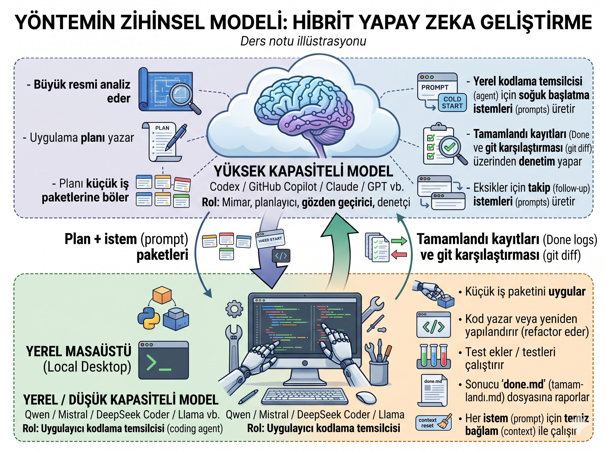
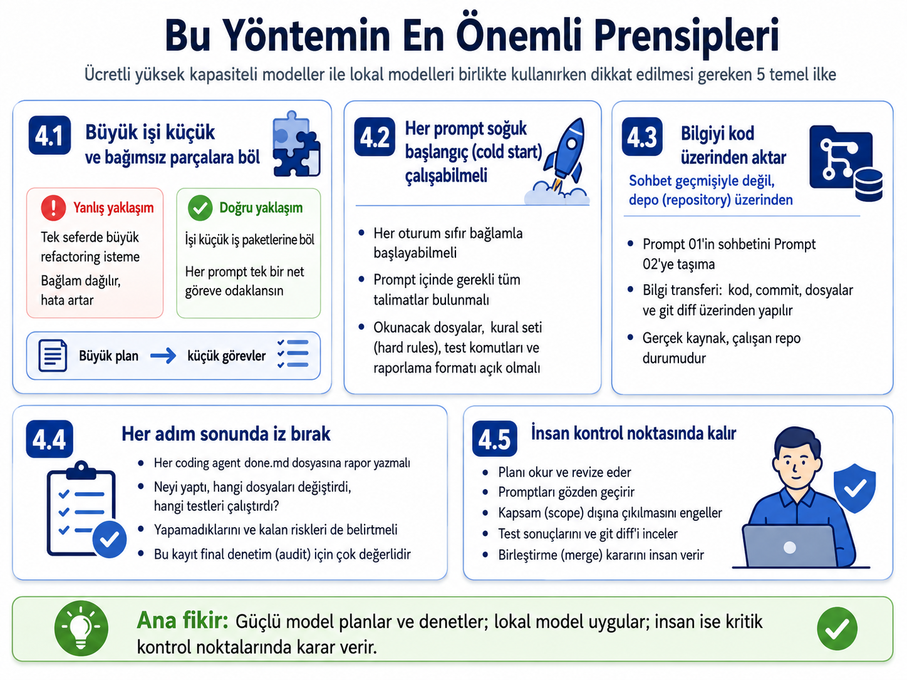
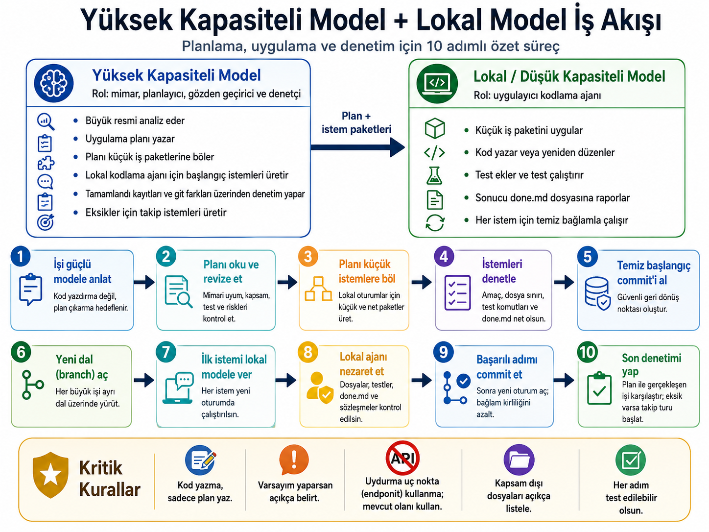

# Ücretli ve Lokal LLM'leri Birlikte Kullanarak Ölçeklenebilir Kod Geliştirme

## Token Harcamadan, Rate Limit'e Takılmadan Büyük Kod Değişiklikleri Nasıl Yönetilir?

Bu ders notu, büyük ve orta ölçekli yazılım projelerinde **yüksek kapasiteli ücretli modelleri** planlama, mimari karar ve kalite kontrol için; **lokalde çalışan daha düşük kapasiteli modelleri** ise kodlama, test yazma ve küçük iş paketlerini uygulama için birlikte kullanma yöntemini anlatır.

Bu yöntem, özellikle RAG Backend gibi çok dosyalı, çok katmanlı ve sürekli refactoring gerektiren projelerde faydalıdır. Amaç, pahalı modeli sürekli kod yazdırmak için kullanmak değil; onu **stratejist, mimar, denetçi ve prompt tasarımcısı** gibi kullanmaktır. Kodlama işi ise mümkün olduğunca lokal model / lokal coding agent tarafından yapılır.

---

## 1. Dersin Ana Fikri

Bu yöntemin merkezinde basit bir ayrım var:

> **Pahalı model düşünsün, lokal model uygulasın.**

Yüksek kapasiteli modelin güçlü olduğu işler:

- Gereksinimi anlama
- Mimari riskleri görme
- Büyük resmi planlama
- İşleri küçük parçalara bölme
- Kalite kontrol ve audit yapma
- Eksikleri tespit edip yeni düzeltme promptları üretme

Lokal modelin güçlü olduğu işler:

- Küçük ve net tanımlanmış kod değişikliklerini uygulama
- Tek dosya veya sınırlı dosya setinde refactoring yapma
- Test ekleme
- Basit doğrulama komutlarını çalıştırma
- Yapılan işi `done.md` gibi bir log dosyasına kaydetme

Bu ayrım sayesinde pahalı modeli her küçük kod değişikliğinde token tüketen bir execution aracı gibi kullanmak yerine, onu projenin üst seviye kontrol mekanizması haline getiririz.

---

## 2. Bu Yönteme Neden İhtiyaç Duydum?

RAG Backend projesi üzerinde çalışırken şu problemler ortaya çıktı:

1. **Token tüketimi hızla arttı.**Büyük bir refactoring için tüm proje bağlamını sürekli güçlü modellere göndermek, token maliyetini ciddi şekilde yükseltti.
2. **Rate limit geliştirme hızını kesti.**Model iyi çalışsa bile yoğun kullanımda rate limit'e takılınca geliştirme akışı durdu.
3. **Büyük işleri tek promptla yaptırmak güvenilir olmadı.**“Admin panelini multi-collection destekli hale getir” veya “RAG backend mimarisini refactor et” gibi büyük isteklerde model ya bazı detayları kaçırdı ya da context içinde yönünü kaybetti.
4. **Uzun konuşma geçmişleri model kalitesini düşürdü.**
   Aynı coding agent session içinde çok fazla değişiklik yaptırınca context window doldu, model önceki hatalı varsayımlara tutundu veya scope dışına çıkmaya başladı.

Bu problemler sonucunda daha disiplinli, parçalara ayrılmış ve denetlenebilir bir **hybrid LLM coding workflow** geliştirdim.

---

## 3. Yöntemin Zihinsel Modeli



```text
+-----------------------------------------------------------+
|                 YÜKSEK KAPASİTELİ MODEL                  |
|        Codex / GitHub Copilot / Claude / GPT vb.          |
|                                                           |
|  Rol: Mimar, planlayıcı, reviewer, denetçi                |
|                                                           |
|  - Büyük resmi analiz eder                                |
|  - Uygulama planı yazar                                   |
|  - Planı küçük iş paketlerine böler                       |
|  - Lokal coding agent için cold start promptları üretir   |
|  - Done logları ve git diff üzerinden audit yapar         |
|  - Eksikler için follow-up promptları üretir              |
+-------------------------+---------------------------------+
                          |
                          | Plan + prompt paketleri
                          v
+-----------------------------------------------------------+
|                    LOKAL / DÜŞÜK KAPASİTELİ MODEL         |
|           Qwen / Mistral / DeepSeek Coder / Llama vb.     |
|                                                           |
|  Rol: Uygulayıcı coding agent                             |
|                                                           |
|  - Küçük iş paketini uygular                              |
|  - Kod yazar veya refactor eder                           |
|  - Test ekler / test çalıştırır                           |
|  - Sonucu done.md dosyasına raporlar                      |
|  - Her prompt için temiz context ile çalışır              |
+-----------------------------------------------------------+
```

Bu yapı yazılım geliştirmede insan ekibine benzer:

- Pahalı model: **Senior architect / tech lead / reviewer**
- Lokal model: **Junior developer / implementation agent**
- İnsan geliştirici: **Product owner + final decision maker + safety brake**
- Git: **Gerçek durum kaydı**
- Testler: **Doğrulama mekanizması**
- `done.md`: **Agent çalışma günlüğü**

---

## 4. Bu Yöntemin En Önemli Prensipleri



### 4.1. Büyük işi küçük ve bağımsız parçalara böl

Lokal modelden büyük bir refactoring istemek yerine ona sınırlı bir görev verilir:

Yanlış yaklaşım:

```text
Tüm RAG backend'i multi-collection mimariye refactor et.
```

Doğru yaklaşım:

```text
Sadece collection registry katmanını ekle.
Sadece şu dosyaları oku.
Sadece şu dosyaları değiştir.
Backend API sözleşmesini değiştirme.
Testleri çalıştır.
Sonucu notes/done.md dosyasına yaz.
```

### 4.2. Her prompt cold start çalışabilmeli

Her lokal coding agent oturumu sıfır bağlamla başlayabilmelidir. Bunun için prompt içinde gerekli tüm talimatlar, okunacak dosyalar, hard rules, test komutları ve raporlama formatı bulunmalıdır.

### 4.3. Kod üzerinden bilgi aktar, sohbet geçmişi üzerinden değil

Prompt 01 bittikten sonra Prompt 02'ye önceki sohbet geçmişini taşıma. Bilgi transferi repository üzerinden yapılır:

```text
Prompt 01 -> Kod değişikliği -> Test -> Commit
Prompt 02 -> Repository'deki güncel kodu okur -> Devam eder -> Test -> Commit
```

### 4.4. Her adım sonunda iz bırak

Her coding agent kendisinin ne yaptığını, hangi dosyaları değiştirdiğini, hangi testleri çalıştırdığını ve neyi yapamadığını `done.md` gibi bir dosyaya yazmalıdır.

Bu dosya final audit için çok değerlidir.

### 4.5. İnsan her zaman kontrol noktasında kalır

Bu workflow otomatik pilot değildir. İnsan geliştirici şu noktalarda aktif kalır:

- Planı okur ve revize eder
- Promptları gözden geçirir
- Lokal modelin scope dışına çıkmasını engeller
- Test sonuçlarını inceler
- Git diff'i kontrol eder
- Merge kararını verir

---

## 5. Adım Adım Hybrid LLM Coding Workflow



### Adım 1 — Geliştirilecek işi yüksek kapasiteli modele anlat

İlk aşamada yapılacak iş, güçlü modele geniş bağlamla anlatılır. Burada amaç kod yazdırmak değil, **plan çıkartmaktır**.

Örnek istek:

```text
RAG Backend projemde admin paneli multi-collection destekli hale getirmek istiyorum.
Bu iş için kod yazma. Önce detaylı bir uygulama planı çıkar.

Plan şunları içersin:
- Mevcut durum analizi
- Etkilenecek dosyalar
- Kullanılacak endpointler
- Değişmeyecek sözleşmeler
- Adım adım implementation sırası
- Her adım için kabul kriterleri
- Her adım için test komutları
- Riskler ve rollback stratejisi
- Lokal coding agent için dikkat edilmesi gereken noktalar
```

Bu aşamanın çıktısı:

```text
notes/adminpanel_plan.md
veya
notes/multicollection_plan.md
```

Plan yazdırırken özellikle şunları isteyin:

- “Kod yazma, sadece plan yaz.”
- “Varsayım yaparsan açıkça belirt.”
- “Endpoint uydurma; mevcut endpointleri kullan.”
- “Kapsam dışı dosyaları açıkça listele.”
- “Her adım test edilebilir olsun.”

### Adım 2 — Planı kendin oku ve revize ettir

LLM'in ürettiği plan nihai gerçek değildir. Mutlaka okunmalı ve gerekirse modele geri verilerek revize ettirilmelidir.

Kontrol soruları:

- Plan mevcut proje mimarisine uyuyor mu?
- Model olmayan endpointler varsaymış mı?
- Gereğinden fazla dosyaya dokunuyor mu?
- Test stratejisi gerçekçi mi?
- İş paketleri lokal model için fazla büyük mü?
- Rollback veya risk azaltma stratejisi var mı?

Revizyon promptu örneği:

```text
Bu planı gözden geçirdim. Şu eksikler var:

1. Admin panel sadece admin/ dizinine dokunmalı.
2. Backend endpointleri değiştirilmeyecek.
3. Her adım sonunda node --check ve npm test komutları eklenmeli.
4. Her agent notes/done.md dosyasına rapor yazmalı.

Planı bu kurallara göre yeniden düzenle.
Kod yazma.
```

### Adım 3 — Planı cold start prompt paketlerine böldür

Plan hazır olduktan sonra yüksek kapasiteli modelden bu planı lokal coding agent oturumlarına verilecek küçük promptlara bölmesini isteyin.

Örnek istek:

```text
Elindeki planı sıfır context ile çalışabilecek coding agent promptlarına böl.

Her prompt şu özelliklere sahip olsun:
- Tek başına anlaşılabilsin.
- Önce okunacak dosyaları söylesin.
- Değiştirilebilecek dosyaları sınırlasın.
- Hard rules bölümüne sahip olsun.
- Uygulama sırasını küçük adımlara bölsün.
- Test ve validation komutlarını içersin.
- Agent'tan notes/done.md dosyasına rapor yazmasını istesin.
- Final cevap formatını tanımlasın.
- Önceki promptların done loglarını okumasını istesin.

Çıktıyı notes/adminpanel_prompts.md formatında üret.
```

Bu aşamanın çıktısı:

```text
notes/adminpanel_prompts.md
veya
notes/multicollection_prompts.md
```

### Adım 4 — Promptları kendin denetle

Prompt dosyasını direkt lokal modele vermeyin. Önce kendiniz okuyun.

Denetim listesi:

- [ ] Her prompt cold start çalışabiliyor mu?
- [ ] Her promptun amacı tek cümlede anlaşılabiliyor mu?
- [ ] Değiştirilebilecek dosyalar sınırlı mı?
- [ ] “Yapma” kuralları açık mı?
- [ ] Test komutları var mı?
- [ ] `done.md` raporu zorunlu mu?
- [ ] Önceki adımların çıktısını koddan ve logdan kontrol ediyor mu?
- [ ] Prompt çok büyük veya belirsiz mi?
- [ ] Lokal modelin varsayım yapmasını engelliyor mu?

Eksik görürseniz promptları tekrar yüksek kapasiteli modele revize ettirin.

### Adım 5 — Temiz başlangıç için git commit al

Plan ve promptlar hazır olduğunda repository'nin temiz bir başlangıç noktası olmalıdır.

Örnek komutlar:

```bash
git status
git add notes/adminpanel_plan.md notes/adminpanel_prompts.md
git commit -m "docs: add admin panel implementation plan and prompts"
```

Bu commit, ileride yanlış bir agent çalışması olursa güvenli dönüş noktası sağlar.

### Adım 6 — Yeni branch aç

Her büyük iş ayrı branch üzerinde yürütülmelidir.

```bash
git checkout -b feature/admin-panel-multicollection
```

Branch adı açık olmalıdır:

```text
feature/admin-panel-multicollection
feature/rag-multicollection-refactor
refactor/vector-store-registry
fix/admin-collection-switcher
```

### Adım 7 — Lokal modele ilk promptu temiz context ile ver

Bu aşamada düşük kapasiteli / lokal coding agent'a geçilir.

Önemli kural:

> Her prompt yeni bir session ile çalıştırılır.

Örnek başlangıç:

```text
Sıfır context ile çalışıyorsun.
Repository'deki notes/adminpanel_plan.md ve notes/adminpanel_prompts.md dosyalarını oku.
Sadece Prompt 00 bölümünü uygula.
Prompt dışına çıkma.
Hard rules bölümüne kesinlikle uy.
İş bitince gerekli testleri çalıştır ve sonucu notes/done.md dosyasına yaz.
```

### Adım 8 — Lokal agent çalışırken nezaret et

Lokal modelin çıktısını pasif şekilde kabul etmeyin. Şu noktalarda kontrol edin:

- Beklenmeyen dosyalara dokundu mu?
- Backend sözleşmesini değiştirdi mi?
- Testleri gerçekten çalıştırdı mı?
- `done.md` dosyasına ne yaptığını yazdı mı?
- Bir hatayı görmezden geldi mi?
- “Yapıldı” dediği şey gerçekten git diff'te var mı?

Kontrol komutları:

```bash
git status
git diff --stat
git diff
npm test
npm run build
```

Projeye göre ek komutlar:

```bash
node --check admin/admin.js
python -m pytest
pytest
npm run lint
npm run typecheck
```

Agent hata yaptıysa aynı session içinde sadece o hatayı düzeltmesini isteyin. Ancak yeni bir prompta geçmeyin.

### Adım 9 — Başarılı adımı commit et, sonra yeni session aç

Prompt tamamlandıysa ve testler geçtiyse commit alın:

```bash
git add .
git commit -m "feat: implement admin collection API client"
```

Sonra yeni prompt için yeni session açın.

Neden?

- Context window dolmasın.
- Önceki konuşmadaki hatalı varsayımlar taşınmasın.
- Lokal model bir sonraki işi temiz şekilde okusun.
- Her prompt bağımsız ve denetlenebilir kalsın.

Doğru döngü:

```text
Prompt 00 -> Lokal agent session 1 -> Test -> done.md -> Commit
Prompt 01 -> Lokal agent session 2 -> Test -> done.md -> Commit
Prompt 02 -> Lokal agent session 3 -> Test -> done.md -> Commit
Prompt 03 -> Lokal agent session 4 -> Test -> done.md -> Commit
```

Yanlış döngü:

```text
Aynı session içinde Prompt 00, 01, 02, 03...
```

Bu yanlış döngü context pollution riskini artırır.

### Adım 10 — Tüm promptlar bitince yüksek kapasiteli modelle audit yap

Tüm lokal promptlar tamamlandığında güçlü modele geri dönülür. Bu kez amacı kod yazmak değil, **plan-gerçekleşen iş karşılaştırması** yapmaktır.

Audit promptu örneği:

```text
Şu dosyaları oku:

- notes/adminpanel_plan.md
- notes/adminpanel_prompts.md
- notes/done.md

Sonra git diff ve mevcut repository durumunu incele.

Aşağıdaki sorulara cevap ver:

1. Orijinal plandaki her adım gerçekten yapılmış mı?
2. Promptlarda istenen her acceptance criteria karşılanmış mı?
3. done.md logları ile gerçek git diff uyumlu mu?
4. Testler yeterli mi?
5. Scope dışı değişiklik var mı?
6. Eksik veya hatalı kalan yerler var mı?

Eksik veya hatalı bir şey bulursan notes/followup_prompts.md dosyasına
lokal coding agent için yeni cold start düzeltme promptları yaz.
Kod yazma; sadece audit ve prompt üret.
```

Audit sonucunda iki ihtimal vardır:

1. Eksik veya hata bulunur.Yeni follow-up promptları üretilir ve lokal model döngüsü tekrar başlar.
2. Eksik bulunmaz ve testler geçer.
   Branch merge edilebilir.

---

## 6. Döngünün Tam Şeması


---

## 7. Örnek Dosya Organizasyonu

Aşağıdaki yapı pratikte işleri düzenli tutar:

```text
notes/
  adminpanel_plan.md
  adminpanel_prompts.md
  adminpanel_done.md
  multicollection_plan.md
  multicollection_prompts.md
  multicollection_done.md
  followup_prompts.md
  audit_report.md
```

Alternatif olarak her iş için ayrı klasör kullanılabilir:

```text
notes/
  2026-06-admin-panel-multicollection/
    plan.md
    prompts.md
    done.md
    audit.md
    followup_prompts.md
```

Bu yapı, ileride aynı yöntemi tekrar anlatırken veya proje geçmişini incelerken çok işe yarar.

---

## 8. Plan Dosyası Şablonu

Aşağıdaki şablon yüksek kapasiteli modelden istenecek plan için kullanılabilir.

```markdown
# <Proje Adı>: <Özellik / Refactoring> Planı

## 1. Amaç

Bu değişiklik neyi çözüyor?
Neden şimdi gerekli?
Kullanıcıya veya geliştiriciye etkisi ne?

## 2. Kapsam

### Kapsam dahilinde

- ...

### Kapsam dışında

- ...

## 3. Mevcut Durum Analizi

- Mevcut mimari nasıl çalışıyor?
- Hangi dosyalar kritik?
- Hangi bağımlılıklar var?
- Hangi testler mevcut?

## 4. Mimari Kararlar

- Karar 1:
- Karar 2:
- Karar 3:

Her karar için gerekçe yaz.

## 5. Riskler

| Risk | Etki | Önlem |
|---|---|---|
| Scope creep | Yüksek | Dosya sınırı koy |
| Endpoint varsayımı | Yüksek | Mevcut koddan doğrula |
| Test eksikliği | Orta | Her prompta test ekle |

## 6. Adım Adım Uygulama Planı

### Adım 0 — Audit

Amaç:
Kod değiştirmeden mevcut durumu analiz et.

Okunacak dosyalar:
- ...

Çıktı:
- notes/done.md içine audit raporu

Test:
- ...

### Adım 1 — <Başlık>

Amaç:
...

Değiştirilecek dosyalar:
- ...

Hard rules:
- ...

Kabul kriterleri:
- ...

Test komutları:
- ...

## 7. Lokal Coding Agent İçin Notlar

- Her prompt tek başına çalışabilmeli.
- Her prompt sonunda done.md güncellenmeli.
- Agent testleri çalıştırmadan işi bitmiş saymamalı.
- Scope dışı dosyalara dokunmamalı.
```

---

## 9. Cold Start Coding Agent Prompt Şablonu

Aşağıdaki format lokal modele verilecek her prompt için kullanılabilir.

````markdown
# Prompt XX — <Kısa Başlık>

## Rolün

Sen bu repository içinde çalışan lokal bir coding agent'sın.
Sıfır context ile çalışıyorsun.
Sadece bu prompttaki talimatları uygula.

## Amaç

<Bu promptta yapılacak işin net açıklaması>

## Önce Oku

Aşağıdaki dosyaları önce oku, sonra değişiklik yap:

- notes/<plan>.md
- notes/<prompts>.md
- notes/done.md
- <ilgili kaynak dosyalar>

## Değiştirebileceğin Dosyalar

- <dosya 1>
- <dosya 2>

## Değiştirmemen Gereken Dosyalar

- <dosya veya klasör>
- Backend API sözleşmeleri
- Migration dosyaları
- Package manager dosyaları

## Hard Rules

- Endpoint uydurma.
- Mevcut testleri silme.
- Scope dışı dosyaları değiştirme.
- Büyük refactoring yapma.
- Emin olmadığın yerde varsayımını notes/done.md içine yaz.
- İş bitince testleri çalıştır.

## Uygulama Sırası

1. Mevcut kodu oku.
2. Planla uyumlu en küçük değişikliği yap.
3. Gerekirse test ekle.
4. Validation komutlarını çalıştır.
5. notes/done.md dosyasına rapor yaz.

## Validation Komutları

```bash
git diff --stat
npm test
npm run build
```

Projeye göre ekle:

```bash
node --check admin/admin.js
pytest
npm run typecheck
```

## done.md Formatı

notes/done.md dosyasına şu formatta ekleme yap:

```markdown
## Prompt XX — <Başlık>

Tarih: <YYYY-MM-DD>

### Yapılanlar

- ...

### Değiştirilen Dosyalar

- ...

### Çalıştırılan Testler

- Komut: ...
  Sonuç: geçti / kaldı

### Yapılamayanlar veya Riskler

- ...

### Sonraki Prompt İçin Notlar

- ...
```

## Final Cevap Formatı

Cevabında sadece şunları yaz:

1. Yapılan değişiklik özeti
2. Değişen dosyalar
3. Çalıştırılan testler ve sonuçları
4. Bilinen riskler
5. done.md güncellendi mi?
````

---

## 10. Final Audit Prompt Şablonu

Yüksek kapasiteli modele verilecek final audit promptu:

```markdown
# Final Audit Görevi

Bu repository'de bir özellik/refactoring işi tamamlandı.
Kod yazma. Önce inceleme yap.

## Okunacak Dosyalar

- notes/<plan>.md
- notes/<prompts>.md
- notes/done.md
- notes/followup_prompts.md varsa oku

## İncelenecek Durum

- git status
- git diff main...HEAD
- test sonuçları
- done.md logları

## Görevlerin

1. Orijinal plan ile mevcut kodu karşılaştır.
2. Promptlarda istenen tüm acceptance criteria karşılanmış mı kontrol et.
3. done.md içinde yazanlarla gerçek git diff uyumlu mu kontrol et.
4. Scope dışı dosya değişikliği var mı kontrol et.
5. Testler yeterli mi kontrol et.
6. Eksik veya hatalı kalan yerleri listele.
7. Eksikler için lokal coding agent'a verilecek yeni cold start promptları üret.

## Çıktı Formatı

### Audit Özeti

- Genel durum:
- Merge'e hazır mı: Evet / Hayır

### Bulunan Eksikler

| No | Eksik | Etki | Kanıt | Önerilen Düzeltme |
|---|---|---|---|---|

### Follow-up Promptları

Eksik varsa notes/followup_prompts.md içine yazılacak promptları üret.
Eksik yoksa açıkça “Follow-up prompt gerekmiyor” yaz.
```

---

## 11. Git Disiplini

Bu yöntemin sağlıklı çalışması için git disiplini kritik önemdedir.

### Başlangıç

```bash
git status
git add notes/<plan>.md notes/<prompts>.md
git commit -m "docs: add implementation plan and coding prompts"
git checkout -b feature/<feature-name>
```

### Her prompt sonrası

```bash
git status
git diff --stat
git diff
npm test
git add .
git commit -m "feat: complete prompt XX - <short summary>"
```

### Hatalı agent değişikliğini geri alma

```bash
git restore <file>
```

veya tüm uncommitted değişiklikleri geri almak için:

```bash
git restore .
```

Dikkat: Bu komut uncommitted değişiklikleri siler. Kullanmadan önce `git diff` ile kontrol edin.

### Final merge

```bash
git checkout main
git pull
git merge feature/<feature-name>
npm test
git branch -d feature/<feature-name>
```

---

## 12. Test Stratejisi

Bu workflow test olmadan güvenilir değildir.

Minimum test katmanları:

1. **Syntax kontrolü** Kod parse ediliyor mu?
2. **Unit test** Küçük fonksiyonlar doğru çalışıyor mu?
3. **Integration test** Modüller birlikte doğru çalışıyor mu?
4. **Manual smoke test** Kullanıcı akışı elle deneniyor mu?
5. **Regression test** Önceden çalışan davranış bozuldu mu?

Örnek validation bölümü:

````markdown
## Validation

Aşağıdaki komutları çalıştır:

```bash
npm run lint
npm run build
npm test
```

Eğer admin panel değiştiyse ayrıca:

```bash
node --check admin/admin.js
```

Manuel test:

1. Admin paneli aç.
2. Collection listesinin yüklendiğini doğrula.
3. Yeni collection oluştur.
4. Var olan collection'ı düzenle.
5. Hata durumunda kullanıcıya anlamlı mesaj gösterildiğini doğrula.
````

---

## 13. Kayıt tutmak (Logging) Neden Önemli?

Kayıt dosyamız olan `done.md`, lokal agentların çalışma günlüğüdür. Final audit sırasında şu sorulara cevap verir:

- Hangi prompt ne yaptı?
- Hangi dosyalar değişti?
- Hangi testler çalıştırıldı?
- Hangi testler başarısız oldu?
- Agent hangi varsayımları yaptı?
- Sonraki agent için not bırakıldı mı?

İyi bir `done.md`, güçlü modelin final audit kalitesini artırır.

Kötü done kaydı:

```markdown
Prompt 2 yapıldı.
```

İyi done kaydı:

```markdown
## Prompt 02 — Collection List View

### Yapılanlar

- admin/admin.js içinde collection list rendering fonksiyonu eklendi.
- API client'taki listCollections fonksiyonu kullanıldı.
- Empty state ve loading state eklendi.

### Değiştirilen Dosyalar

- admin/admin.js
- admin/admin.css

### Testler

- node --check admin/admin.js: geçti
- npm test: geçti

### Riskler

- Manuel tarayıcı testi henüz yapılmadı.
```

---

## 14. Lokal Model İçin Scope Nasıl Küçültülür?

Lokal modelden iyi sonuç almak için işi küçültmek gerekir.

Kötü prompt:

```text
Admin paneli baştan sona düzelt.
```

İyi prompt:

```text
Sadece admin/admin.js dosyasında listCollections API çağrısını kullanan
loadCollections fonksiyonunu ekle.
UI rendering yapma.
Backend dosyalarına dokunma.
Test olarak node --check admin/admin.js çalıştır.
Sonucu notes/done.md dosyasına yaz.
```

Daha iyi prompt:

```text
Sadece şu üç fonksiyonu ekle:

1. normalizeCollection(raw)
2. listCollections()
3. setCollectionsState(collections)

Başka UI fonksiyonu yazma.
Var olan API endpointlerini değiştirme.
node --check admin/admin.js çalıştır.
```

---

## 15. Sık Yapılan Hatalar

### Hata 1 — Plan yazdırmadan kod yazdırmak

Sonuç:

- Model hızlı başlar ama mimariyi kaçırır.
- Kapsam büyür.
- Sonradan düzeltme maliyeti artar.

Çözüm:

- Önce plan.
- Sonra prompt paketleri.
- En son lokal execution.

### Hata 2 — Aynı session içinde çok prompt çalıştırmak

Sonuç:

- Context window şişer.
- Model eski varsayımlara takılır.
- Hatalar bir sonraki adıma taşınır.

Çözüm:

- Her prompt için yeni session.
- Bilgi transferi repository ve `done.md` üzerinden.

### Hata 3 — done.md istememek

Sonuç:

- Final audit zorlaşır.
- Agent'ın gerçekten ne yaptığı belirsizleşir.

Çözüm:

- Her promptta done.md formatı zorunlu olsun.

### Hata 4 — Test komutu eklememek

Sonuç:

- “Çalışıyor gibi görünen” ama kırık kod üretilir.

Çözüm:

- Her promptun sonunda test komutları olsun.
- Test çalışmadan prompt bitmiş sayılmasın.

### Hata 5 — Pahalı modeli sadece kod yazdırmak için kullanmak

Sonuç:

- Token maliyeti artar.
- Rate limit'e takılma ihtimali yükselir.
- Asıl değerli olan mimari analiz gücü boşa harcanır.

Çözüm:

- Pahalı model: plan, prompt, audit.
- Lokal model: uygulama.

---

## 16. Bu Workflow Ne Zaman Kullanılmalı?

Kullanılmalı:

- Çok dosyalı refactoring yaparken
- Büyük feature geliştirirken
- RAG, agent, admin panel, API refactor gibi katmanlı işlerde
- Token maliyeti önemliyse
- Rate limit geliştirmeyi yavaşlatıyorsa
- Lokal model altyapınız varsa
- Her adımı testlerle doğrulayabiliyorsanız

Kullanılmayabilir:

- Tek satırlık bug fix için
- Çok küçük UI metin değişikliği için
- Test altyapısı hiç yoksa
- Repository çok dağınıksa ve önce insan eliyle toparlanması gerekiyorsa

Ama küçük işler için bile bu yöntemin mini versiyonu kullanılabilir:

```text
1. Güçlü modele mini plan yazdır.
2. Lokal modele tek prompt ver.
3. Test et.
4. Commit al.
5. Güçlü modele hızlı review yaptır.
```

---

## 17. RAG Backend Projesinden Çıkan Dersler

Bu yöntem RAG Backend projesinde özellikle şu noktalarda faydalı oldu:

1. **Multi-collection refactoring daha yönetilebilir hale geldi.** Büyük mimari değişiklikler tek seferde değil, registry, API, UI, test ve audit gibi parçalara bölündü.
2. **Admin panel değişikliklerinde scope kontrolü sağlandı.** Lokal modelin backend dosyalarına dokunması engellendi.
3. **Token tüketimi azaltıldı.** Yüksek kapasiteli model tüm kodlama detayları için değil, kritik planlama ve audit için kullanıldı.
4. **Hatalar daha erken yakalandı.** Her prompt sonrası test ve git diff kontrolü yapıldığı için hata büyümeden görüldü.
5. **Model çıktısı izlenebilir hale geldi.** `done.md` sayesinde hangi agentın ne yaptığı sonradan incelenebildi.

---

## 18. Kısa Kontrol Listesi

Her iş başlamadan önce:

- [ ] Plan dosyası var mı?
- [ ] Prompt dosyası var mı?
- [ ] Promptlar cold start çalışıyor mu?
- [ ] Hard rules açık mı?
- [ ] Test komutları var mı?
- [ ] done.md formatı tanımlı mı?
- [ ] Git temiz mi?
- [ ] Yeni branch açıldı mı?

Her prompt sonrası:

- [ ] Agent sadece izin verilen dosyalara dokundu mu?
- [ ] Testler çalıştı mı?
- [ ] Test sonuçları kaydedildi mi?
- [ ] done.md güncellendi mi?
- [ ] Git diff incelendi mi?
- [ ] Commit alındı mı?
- [ ] Yeni prompt için yeni session açıldı mı?

Final audit sonrası:

- [ ] Plan ile gerçek kod uyumlu mu?
- [ ] Eksik acceptance criteria var mı?
- [ ] Scope dışı değişiklik var mı?
- [ ] Tüm testler geçiyor mu?
- [ ] Follow-up prompt gerekiyor mu?
- [ ] Merge kararı güvenli mi?

---

## 19. En Kısa Özet

Bu yöntemi tek paragrafta şöyle özetleyebiliriz:

> Büyük kod değişikliklerinde yüksek kapasiteli ücretli modeli doğrudan kod yazdırmak için değil, planlama, prompt üretimi ve kalite kontrol için kullanıyorum. Planı küçük, bağımsız ve cold start çalışabilecek promptlara böldürüyorum. Bu promptları lokal coding agentlara temiz context ile sırayla uygulatıyorum. Her adım test ediliyor, `done.md` dosyasına raporlanıyor ve commitleniyor. Tüm adımlar bitince güçlü model plan, promptlar, done logları ve git diff üzerinden final audit yapıyor. Eksik varsa yeni promptlar üretiyor; eksik yoksa branch merge ediliyor.

---

## 20. Son Söz

Bu workflow'un başarısı model seçiminden çok süreç disiplinine bağlıdır.

Küçük modeller çoğu zaman “yetersiz” oldukları için değil, onlara büyük, belirsiz ve denetlenmeyen işler verildiği için başarısız olur. İşi küçük parçalara böler, her parçaya net kurallar koyar, test ve log zorunluluğu eklerseniz lokal modeller oldukça verimli hale gelir.

Benim için en önemli ders şu oldu:

> **Context pahalıdır. Dikkat de pahalıdır. Bu yüzden ikisini de bilinçli yönetmek gerekir.**

Pahalı modeli her şeyi yapan bir sihirli araç gibi değil, doğru zamanda devreye giren bir mimar ve denetçi gibi kullanmak; lokal modeli ise iyi tanımlanmış işleri uygulayan bir execution aracı olarak konumlandırmak, büyük projelerde hem maliyeti düşürür hem de kontrolü artırır.

---

*Bu ders notu, RAG Backend projesinde kullanılan gerçek bir hybrid LLM coding workflow deneyiminden yola çıkarak hazırlanmıştır.*
