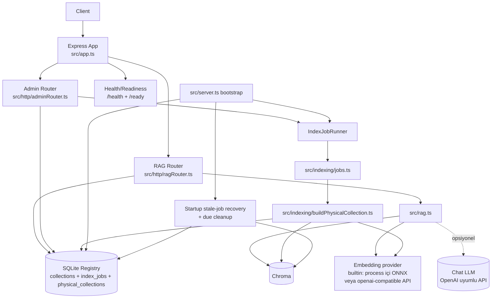

# Radar RAG Mimarisi

> Radar RAG'in (eski adı Vanilla RAG Backend) mimari gerekçesi. Bu dokümanda "vanilla RAG", retrieval ve generation adımlarını doğrudan birbirine bağlayan temel (textbook) RAG akışının adı olarak kullanılıyor.

## 1. Amaç ve Kapsam

Bu dokümanın amacı iki şeyi aynı yerde birleştirmektir:

1. Vanilla bir RAG backend'in teoride hangi temel bileşenlerden oluştuğunu netleştirmek.
2. Bu teorik mimarinin bu repoda hangi dosyalar ve akışlar ile nasıl implement edildiğini açıklamak.

Bu repo bir "agentic RAG" sistemi değil, bir "Vanilla RAG backend" implementasyonudur.
Buradaki hedef, tek bir kullanıcı sorusunu alıp:

1. uygun belgeleri bulmak,
2. bu belgelerden ilgili parçaları çıkarmak,
3. bu bağlamı LLM'e vermek,
4. cevabı API üzerinden geri döndürmektir.

Bu nedenle mimari kasti olarak basit tutulmuştur. Router, tool orchestration, self-reflection, multi-hop planning veya agent loop yoktur.

## 2. Vanilla RAG Backend Nedir?

Vanilla RAG backend, retrieval ve generation adımlarını doğrudan birbirine bağlayan en temel backend mimarisidir.

En yalın haliyle şu akıştan oluşur:

1. Veri kaynağını oku.
2. Belgeleri modele uygun chunk'lara böl.
3. Chunk'ları embedding'e çevir.
4. Embedding'leri bir vector store'a yaz.
5. Kullanıcı sorusu geldiğinde soruyu embed et.
6. En benzer chunk'ları getir.
7. Bu chunk'ları prompt içinde LLM'e ver.
8. Cevabı istemciye döndür.

Bu yaklaşımda backend'in esas görevi, retrieval ile generation arasındaki sözleşmeyi kurmaktır.

## 3. Bu Reponun Mimari Kararı

Bu repo Vanilla RAG'i backend olarak şu prensiplerle kuruyor:

- HTTP API katmanı ile RAG orkestrasyonu birbirinden ayrılıyor.
- İndeksleme akışı ile query akışı birbirinden ayrılıyor.
- LangChain, retrieval ve model entegrasyon katmanı olarak kullanılıyor.
- Chroma, vector store olarak kullanılıyor.
- Embedding'ler LangChain `Embeddings` arayüzü üzerinden iki provider'dan birinden gelir: `builtin` (varsayılan; `onnx-community/embeddinggemma-2-ONNX`, q8, tokenizer ile ~346 MB, transformers.js v4 ile backend process'i içinde CPU'da çalışır, ilk kullanımda `embedding.cacheDir` klasörüne bir kez indirilir; harici servis gerekmez) veya `openai-compatible` (`OpenAIEmbeddings` ile herhangi bir OpenAI uyumlu `/v1/embeddings` API'si: Ollama `http://localhost:11434/v1`, OpenAI, LM Studio, vLLM...). Backend artık Ollama'ya bağımlı değildir; Ollama sadece `openai-compatible` provider'ın (veya chat LLM'in) olası hedeflerinden biridir.
- Cevap üretimi (generation) opsiyoneldir: tek bir global chat LLM, LangChain `ChatOpenAICompletions` (`@langchain/openai`) ile herhangi bir OpenAI uyumlu chat completions API'sine (Ollama `http://localhost:11434/v1`, LM Studio, vLLM, OpenAI, OpenRouter...) bağlanır. Chat LLM yapılandırılmamışsa backend retrieve-only çalışır: `/retrieve` ve indexing çalışır, `/query` kapalıdır. Varsayılan (shipped) config retrieve-only'dir.
- Konfigürasyon merkezi bir `config` objesi ile yönetiliyor.

Bu kararların sonucu olarak proje, minimal ama okunabilir bir backend omurgası elde ediyor.

## 4. Üst Seviye Mimari



Bu diyagramda iki ana hat vardır:

- Runtime query/retrieve handling hattı
- Registry-backed admin/indexing hattı

### 4.1 Multi-Collection Control Plane

Bu repodaki gerçek multi-collection davranışı aşağıdaki control-plane kuralları ile kuruludur:

1. Logical collection source of truth SQLite registry'dir. `collections`, `index_jobs` ve `physical_collections` tabloları kullanıcıya açık logical kimliği, job state'ini ve fiziksel Chroma lifecycle'ını ayrı tutar.
2. Public `collectionId` tenant-scoped ve stabildir. Request context `x-tenant-id`, `x-user-id` ve `x-request-id` header'larından üretilir; Chroma içindeki fiziksel collection adı bu public kimlikten ayrıdır.
3. Her rebuild yeni bir versioned physical Chroma collection üretir. `targetPhysicalCollection` ve `targetVersion` registry job kaydında tutulur.
4. Job lifecycle açıkça `queued -> running -> succeeded|failed` state'leri ile izlenir. Job source of truth SQLite registry'dir; process içi runner sadece background promise lifecycle'ını yönetir.
5. Başarılı build sonrası aktif pointer transaction içinde atomik olarak yeni physical collection'a çevrilir. Böylece aktif eski sürüm varsa rebuild sırasında query/retrieve kesilmez.
6. Önceki aktif fiziksel collection hemen silinmez. Registry'de `delete_pending` durumuna alınır, `delete_after = now + cleanup.retentionMs` set edilir ve due cleanup aşamasında silinir. `cleanup_failed` kayıtları daha sonra yeniden denenebilir. Storage delete "not found" dönerse cleanup idempotent başarı kabul edilir ve kayıt `deleted` yapılır; build sırasında başarısız olan hedef fiziksel kayıt ise `failed_build` kalır ve retention cleanup'a girmez.
7. `GET /ready` registry-aware'dir; ama collection-aware değildir. Registry, Chroma, varsayılan embedding (yeni koleksiyonlar için yapılandırılmış provider/model), opsiyonel chat LLM ve indexing source erişimini kontrol eder. Default collection yok diye fail etmez.
8. `GET /v1/rag/collections/:collectionId/ready` seçili logical collection'ın `activeJob`, `activeVersion`, `chromaReadable`, `chromaCount` ve capability alanlarını döndürür.
9. Access kontrolünde `403/404` ayrımı vardır. Collection global olarak varsa ama request tenant'ı göremiyorsa `403 COLLECTION_FORBIDDEN`; hiç yoksa `404 COLLECTION_NOT_FOUND` döner.
10. HTTP katmanında request rate limiter merkezi middleware olarak çalışır; limit anahtarı `tenantId`, `userId`, `collectionId` ve operation (`query`, `retrieve`, `reindex`) alanlarından oluşur. Model tarafında ayrıca `maxConcurrentEmbeddings` ve `maxConcurrentGenerations` ile backpressure uygulanır.
11. Aktif read path, her zaman aktif fiziksel koleksiyonun build edildiği embedding provider/model çiftini (`activeEmbeddingProvider` + `activeEmbeddingModel`) kullanır; yapılandırılmış varsayılan embedding'e asla düşmez. Varsayılan embedding (`embedding.provider` / `embedding.model`) sadece yeni koleksiyonlara uygulanır ve mevcut koleksiyonları hiç değiştirmez. Admin tarafından `embeddingProvider` veya `embeddingModel` (desired) değeri değiştirilse bile, bu değer yeni bir reindex işi başarıyla tamamlanıp aktif pointer swap yapılana kadar mevcut okuma modelini etkilemez; swap, job'un gerçekten build ettiği `targetEmbeddingProvider` / `targetEmbeddingModel` çiftini aktif çift olarak kaydeder. Bu, model uyuşmazlığı (dimension mismatch vb.) riskini ortadan kaldırarak zero-downtime okuma sağlar. Failed reindex durumunda eski aktif snapshot korunur.

## 5. Temel Bileşenler

### 5.1 API Katmanı

Teorik rol:

- Dış dünyadan gelen istekleri kabul eder.
- Request validation yapar.
- RAG orkestrasyonunu çağıran giriş noktası olur.
- Sonucu JSON olarak döndürür.

Repodaki implementasyon:

- API kompozisyonu [src/app.ts](src/app.ts) içinde kuruludur.
- [src/server.ts](src/server.ts) yalnızca bootstrap yapar: SQLite registry, job runner, stale job recovery, due cleanup ve `listen` çağrısı.
- HTTP yüzeyi [src/http/adminRouter.ts](src/http/adminRouter.ts) ve [src/http/ragRouter.ts](src/http/ragRouter.ts) üzerinden ayrıştırılmıştır.
- Zod ile request body'leri validate edilir.
- Başarılı validation sonrası collection resolution, registry access ve RAG yardımcıları çağrılır.

Bu dosyanın backend mimarisindeki görevi şu sınırda tutulmuştur:

- HTTP parsing
- validation
- hata mapleme
- response döndürme

Bu tasarım doğrudur; çünkü retrieval ve prompt orkestrasyonu API katmanına gömülmemiştir.

#### 5.1.1 Mevcut Endpoint Yüzeyi

Repodaki HTTP yüzeyi şu başlıca endpointlerden oluşur:

- `GET /`
- `GET /health`
- `GET /ready`
- `POST /v1/admin/collections`
- `PATCH /v1/admin/collections/:collectionId`
- `POST /v1/admin/collections/:collectionId/reindex`
- `GET /v1/admin/jobs/:jobId`
- `GET /v1/rag/collections`
- `GET /v1/rag/collections/:collectionId`
- `GET /v1/rag/collections/:collectionId/ready`
- `POST /v1/rag/collections/:collectionId/retrieve`
- `POST /v1/rag/collections/:collectionId/query`

Bu yüzey, query/retrieve akışını, collection discovery'yi, admin lifecycle'ı ve operasyonel sağlık bilgisini aynı backend sınırı içinde toplar. CLI akışı (`npm run onboard`, `npm run index`) operatör kolaylığı için vardır; HTTP admin yüzeyiyle aynı registry kurallarını izler.

#### 5.1.2 Admin Auth, RBAC ve Signed Action Token

Admin yüzeyi bu repoda opsiyonel bir güvenlik katmanı ile sertleştirilmiştir:

1. `adminAuth.enabled=true` olduğunda `/admin` ve `/v1/admin/**` session cookie ile korunur.
2. Session cookie `HttpOnly`, `SameSite=Lax`, path `/` ve production'da `Secure` olarak ayarlanır.
3. Kullanıcılar config içindeki `adminAuth.users[]` listesinden gelir; plaintext password tutulmaz, scrypt hash zorunludur.
4. `viewer`, `operator` ve `admin` rolleri admin route capability matrix'i ile eşlenir.
5. Mutating admin route'lar kısa ömürlü, tek kullanımlık ve route/method/tenant bağlı `x-admin-action-token` ister.
6. Public `/v1/rag` contract'ı bu fazda değişmez; admin UI tenant ve user bilgisini session'dan türetip bu header'ları kendi RAG çağrılarına ekler.

#### `GET /v1/rag/collections`

Maksat:

- Kullanıcının tenant kapsamında görebildiği logical collection kayıtlarını listelemek.
- Pahalı Chroma/embedding probe çalıştırmadan hızlı collection discovery sağlamak.

Çıktı:

- `collections[]`
- Her item için `id`, `displayName`, `description`, `status`, `activeVersion`, `chunkCount`, `updatedAt`
- Her item için `readyUrl`, `queryUrl`, `retrieveUrl`
- Henüz aktif index yoksa `activeVersion` ve `chunkCount` alanları `null` döner; alanlar response shape'inden düşürülmez.

Bu endpoint `capabilities.query` veya `capabilities.retrieve` döndürmez. Liste sadece registry-level discovery kontratıdır; gerçek query/retrieve uygunluğu `GET /v1/rag/collections/:collectionId/ready` cevabındaki `capabilities` alanından okunmalıdır.

#### `GET /`

Maksat:

- Servisin ayakta olduğunu basitçe göstermek
- Tüketiciye ana endpoint'leri tek yerde göstermek

Girdi:

- Request body yok
- Query parameter yok

Çıktı:

- `name`
- `status`
- `message`
- `endpoints`

Tipik kullanım:

- İnsan tarafından hızlı kontrol
- Backend bootstrap bilgisi
- Consumer geliştiricisine self-documenting giriş noktası sağlama
- İç config detaylarını expose etmeden temel endpoint keşfi sağlama

#### `GET /health`

Maksat:

- Liveness kontrolü yapmak
- Process'in ayakta olduğunu dependency probe çalıştırmadan göstermek

Girdi:

- Request body yok
- Query parameter yok

Çıktı:

- `status`
- `alive`
- `port`
- `uptimeSec`
- `timestamp`

Davranış:

- Bu endpoint Chroma, embedding provider veya collection durumunu kontrol etmez.
- Amaç, sadece backend prosesinin cevap verip vermediğini göstermektir.

Bu ayrım önemlidir; çünkü liveness ile readiness aynı problem değildir.

#### `GET /ready`

Maksat:

- Sistemin gerçekten neye hazır olduğunu açıklamak
- Retrieve, RAG query çalıştırma ve indexing başlatma hazırlığını ayrı ayrı raporlamak
- Operasyonel blocker, warning ve önerilen aksiyonları döndürmek

Girdi:

- Request body yok
- Opsiyonel query parameter'lar:
    - `details=true`
    - `strict=true`

Çıktı:

- Varsayılan çağrıda kısa readiness özeti döner:
    - `status`
    - `ready`
    - `systemReadyFor`
    - `overallSummary`
    - `retrieveReady`
    - `queryEnabled`
    - `queryReady`
    - `indexReady`
    - `retrieveSummary`
    - `querySummary`
    - `indexSummary`
    - `blockerCodes`
    - `warningCodes`
    - `recommendedActions`
    - `dependencies.registry.ok`
    - `dependencies.chroma.ok`
    - `dependencies.embedding.ok`
    - `dependencies.chat.ok` / `dependencies.chat.configured`
    - `config.chatModel` (chat LLM yoksa `null`)
    - `config.embeddingProvider` / `config.embeddingModel` (yeni koleksiyonlar için varsayılan embedding)
    - `diagnostics`
- `details=true` verildiğinde ayrıntılı payload açılır ve ayrıca şu alanlar görünür:
    - `checks`
    - `blockers`
    - `warnings`
    - `capabilities.retrieve`, `capabilities.query` (`enabled` alanıyla), `capabilities.index`
    - `dependencies` (`dependencies.chat`: `configured`, `baseUrl`, `model`, `reachable`, `authOk`, `modelListed`, `ok`, `latencyMs`, `httpStatus?`, `availableModels?`, `error?`; API key asla dönmez; `dependencies.embedding`: `provider`, `model`, `configured`, `supported`, `ok`, `latencyMs`, `downloaded?`, `approxDownloadMb?`, `reachable?`, `authOk?`, `modelListed?`, `availableModels?`, `httpStatus?`, `error?`)
    - `dataSource`

Kontrol ettiği başlıca şeyler:

- Chroma erişilebilir mi
- Varsayılan embedding (yeni koleksiyonlar için yapılandırılmış provider/model) kullanılabilir mi: `builtin` için model katalogda mı ve cache'e indirilmiş mi; `openai-compatible` için `embedding.baseUrl` yapılandırılmış mı, servis erişilebilir mi, API key kabul ediliyor mu ve model listede var mı
- Chat LLM yapılandırılmış mı; yapılandırılmışsa erişilebilir mi, API key kabul ediliyor mu ve model listede var mı
- Veri dosyası okunabilir mi
- Örneklem içinde indexlenebilir doküman var mı

Chat LLM kontrolü ücretsiz ve 30 saniye cache'lenen bir `GET {chat.baseUrl}/models` isteğidir; `/ready` hiçbir zaman generation çalıştırmaz (gerçek generation smoke test'i yalnızca `npm run onboard` içinde koşar). Check kodları sadece `query` capability'sini etkiler: `CHAT_NOT_CONFIGURED` (skip, blocking değil), `CHAT_PROVIDER_UNREACHABLE`, `CHAT_PROVIDER_AUTH_FAILED`, `CHAT_MODEL_MISSING` (fail, sadece query'yi bloklar), `CHAT_MODEL_UNVERIFIED` (warn: provider model listesi sunmuyor), `CHAT_MODEL_AVAILABLE` (pass). Chroma, registry ve embedding check'leri `retrieve`, `query` ve `index` capability'lerini birlikte etkiler.

Embedding kontrolü de ucuzdur ve `/ready` hiçbir zaman embedding çalıştırmaz, model indirmez: `builtin` için katalog + cache kontrolü, `openai-compatible` için ücretsiz ve 30 saniye cache'lenen bir `GET {embedding.baseUrl}/models` isteği yapılır. Sadece yapılandırılmış varsayılan embedding kontrol edilir; mevcut koleksiyonlar kendi aktif provider/model çiftleriyle `GET /v1/rag/collections/:collectionId/ready` içinde kontrol edilir. Check kodları: `EMBEDDING_MODEL_READY` (pass), `EMBEDDING_MODEL_NOT_DOWNLOADED` (warn, blocking değil: built-in model ilk indexing'de bir kez indirilir), `EMBEDDING_MODEL_UNVERIFIED` (warn: servis model listesi sunmuyor), `EMBEDDING_MODEL_UNSUPPORTED`, `EMBEDDING_PROVIDER_NOT_CONFIGURED`, `EMBEDDING_PROVIDER_UNREACHABLE`, `EMBEDDING_PROVIDER_AUTH_FAILED`, `EMBEDDING_MODEL_MISSING` (fail; sadece `index`'i bloklar: varsayılan embedding yalnızca yeni koleksiyonların indekslenmesinde kullanılır, mevcut koleksiyonlarda arama açık kalır). Eski `OLLAMA_*`, `EMBED_MODEL_*` ve `EMBED_SMOKE_*` kodları kaldırılmıştır.

Readiness semantiği:

- `ready = retrieveReady && indexReady && (!queryEnabled || queryReady)`. Chat LLM'siz (retrieve-only) bir kurulum da `ready: true` olabilir.
- `queryReady`, chat LLM yapılandırılmamışsa her zaman `false`'tur; `querySummary` bu durumda `/query`'nin neden kapalı olduğunu açıklar.
- `systemReadyFor` değerleri: `query-and-index`, `retrieve-and-index`, `query`, `retrieve`, `index`, `neither`. Örnek: retrieve-only kurulumda varsayılan dış embedding servisi kapalıysa `retrieve`.

HTTP durum semantiği:

- Varsayılan `/ready` çağrısı her zaman `200` döner ve gerçek durumu JSON içindeki `ready`, `retrieveReady`, `queryReady`, `indexReady` alanlarında bildirir.
- `strict=true` verildiğinde ve sistem hazır değilse `503` döner.

Not: Eski mimaride varsayılan koleksiyon kontrol ediliyordu. Multi-collection sonrası bu genel `/ready` rotası *koleksiyondan bağımsız* sadece sistem bağımlılıklarını (Chroma, varsayılan embedding, chat LLM vb.) ölçer. Spesifik koleksiyon bazlı sağlık durumu için `GET /v1/rag/collections/:collectionId/ready` kullanılır.

#### `GET /v1/rag/collections/:collectionId/ready`

Maksat:

- Seçili koleksiyonun erişilebilirliğini ve index durumunu raporlamak.

Çıktı:

- `activeJob`
- `activeVersion`
- `chromaReadable`
- `chromaCount`
- `modelAvailability.embeddingProvider` / `modelAvailability.embeddingModel` (aktif index'in build edildiği çift; okumalar bunu kullanır)
- `modelAvailability.embeddingModelAvailable`
- `modelAvailability.desiredEmbeddingProvider` / `modelAvailability.desiredEmbeddingModel` (sadece kaydedilmiş çift aktif çiften farklıysa; reindex sonrası geçerli olur)
- `modelAvailability.chatModel` (global chat LLM modeli; yapılandırılmamışsa `null`)
- `modelAvailability.chatModelAvailable` (chat provider kontrolünün sonucu)
- `status`
- `hasActivePhysicalCollection`
- `capabilities.query`
- `capabilities.retrieve`
- `capabilities.reindex`

Bu endpoint, sorgu yapmadan önce koleksiyonun endekslenip endekslenmediğini ya da "indexing" statüsünde olup olmadığını kullanıcıya bildirir. Aktif fiziksel koleksiyon okunabiliyorsa, koleksiyon statüsü `indexing` olsa bile `capabilities.query=true` ve `capabilities.retrieve=true` kalabilir; böylece rebuild sırasında eski aktif sürümden sorgu servis edilmeye devam eder. Ancak koleksiyonun okuma için kullandığı aktif embedding provider/model çifti kullanılamıyorsa (built-in model katalogda değil, `openai-compatible` servis yapılandırılmamış/erişilemiyor/key reddediliyor ya da model listede yok) bu durum `modelAvailability` alanında görünür, ilgili `EMBEDDING_*` kodu `blockers` içine girer ve `query`/`retrieve` capability bayrakları düşer. `EMBEDDING_MODEL_NOT_DOWNLOADED` ve `EMBEDDING_MODEL_UNVERIFIED` ise sadece `warnings` içinde görünür ve capability'leri düşürmez. Chat modeli koleksiyona ait değildir; global ve opsiyonel chat LLM sadece `capabilities.query`'yi etkiler (`capabilities.query = retrieve && chat yapılandırılmış && provider ok`). `CHAT_NOT_CONFIGURED` ve `CHAT_MODEL_UNVERIFIED` `warnings` içinde, `CHAT_PROVIDER_UNREACHABLE` / `CHAT_PROVIDER_AUTH_FAILED` / `CHAT_MODEL_MISSING` ise `blockers` içinde görünür; bunlar retrieve'i etkilemez.

#### `POST /v1/rag/collections/:collectionId/query`

Maksat:

- Seçilen mantıksal (logical) koleksiyon üzerinden kullanıcı sorusunu alıp retrieval + generation akışını çalıştırmak
- Sonucu answer + sources şeklinde JSON olarak döndürmek

Bu endpoint opsiyoneldir: global chat LLM yapılandırılmamışsa (varsayılan) body doğrulamasından ve koleksiyon lookup'ından önce `503 CHAT_NOT_CONFIGURED` döner (`Retry-After` header'ı yoktur; bu geçici bir yük değil, bir konfigürasyon durumudur). Bu durumda istemci `/retrieve` kullanmalıdır.

Girdi:

- JSON request body (Limit 1MB, asılırsa 413 Payload Too Large)
- Zorunlu alan: `question: string`

Örnek girdi:

```json
{
    "question": "Turizm amaçlı kiralama izin belgesi alınmış konutun kiraya verilmesi nasıl vergilendirilir?"
}
```

Başarılı çıktı:

- `answer: string`
- `distanceScoreThreshold: number`
- `sources: Array<{ documentId?, sourcePath?, sourceType?, chunkIndex?, distanceScore?, content }>`
- `collectionId: string`
- `collectionDisplayName: string`
- `activeVersion: string`
- `embeddingProvider: "builtin" | "openai-compatible"` (koleksiyonun aktif embedding provider'ı)
- `embeddingModel: string`
- `chatModel: string` (cevabı üreten global chat LLM modeli)

`observability.includeDebugTimings=false` iken query response bu alanlarla sınırlı kalır. Config `true` yapılırsa response'a `debug.latency.retrievalMs`, `debug.latency.generationMs` ve `debug.latency.totalMs` eklenir.

Örnek hata durumları:

- `400`: body geçersizse veya `question` boşsa
- `413`: Gönderilen JSON gövdesi çok büyükse
- `404`: Koleksiyon (veya ilgili aktif versiyon) bulunamazsa (`COLLECTION_NOT_FOUND` / `COLLECTION_NOT_READY`)
- `503`: Koleksiyon ilk defa endeksleniyorsa (`COLLECTION_INDEXING`)
- `422`: retrieval eşiği altında chunk kalmazsa (`NO_RELEVANT_CONTEXT`) veya retrieved chunk'lar cevap üretmeye yetmezse (`ANSWER_NOT_IN_RETRIEVED_CONTEXT`)
- `502`: model boş cevap dönerse (`EMPTY_MODEL_RESPONSE`) veya yasaklı fallback answer dönerse (`DISALLOWED_FALLBACK_ANSWER`)
- `429`: request rate limiter tenant/user/collection/operation anahtarı için limiti aştığında (`RATE_LIMIT_EXCEEDED`)
- `503`: Eşzamanlı istek limiti aşıldığında, generation kuyruğunda bekleme süresi dolduğunda veya client timeout'a düştüğünde (`MODEL_BACKPRESSURE`)
- `503`: chat LLM yapılandırılmamışsa (`CHAT_NOT_CONFIGURED`) veya chat API'sine ulaşılamıyorsa (`CHAT_PROVIDER_UNREACHABLE`)
- `502`: chat API HTTP hatası dönerse (`CHAT_PROVIDER_ERROR`; ör. geçersiz key 401, bilinmeyen model 404, 429, 5xx). `details` içinde `upstreamStatus`, `providerMessage` (API key redakte edilmiş), `chatModel`, `embeddingModel` bulunur
- `503`: koleksiyon `openai-compatible` embedding kullanıyor ama `embedding.baseUrl` yapılandırılmamışsa (`EMBEDDING_PROVIDER_NOT_CONFIGURED`), embedding servisine ulaşılamıyorsa ya da built-in model indirilemiyor/yüklenemiyorsa (`EMBEDDING_PROVIDER_UNREACHABLE`)
- `502`: embedding servisi HTTP hatası dönerse (`EMBEDDING_PROVIDER_ERROR`; `details` içinde `upstreamStatus`, `providerMessage` (API key redakte edilmiş), `embeddingProvider`, `embeddingModel`)
- `409`: soru vektörünün boyutu koleksiyon index'iyle uyuşmuyorsa (`EMBEDDING_DIMENSION_MISMATCH`; `details.expectedDimensions`, `details.gotDimensions`; çözüm reindex'tir)
- `500`: beklenmeyen başka backend hatası oluşursa

Önemli not:

- Backend, koleksiyon okunabilirliğini Langchain'e bırakmadan önce `resolveReadableCollection` katmanında bizzat Chroma'ya sorarak (`assertChromaCollectionReadable`) teyit eder. Bu, yanlışlıkla boş koleksiyon oluşturma riskini (zero-downtime) ortadan kaldırır.

Bu endpoint, repodaki asıl ürün endpoint'idir. Vanilla RAG backend hedefi açısından en kritik API yüzeyi budur.

#### `POST /v1/rag/collections/:collectionId/retrieve`

Maksat:

- Kullanıcının sorusu için generation çalıştırmadan yalnızca retrieval sonucunu döndürmek
- Debug, evaluation ve observability için retrieval katmanını ayrı görünür hale getirmek

Girdi:

- JSON request body
- Zorunlu alan: `question: string`
- Opsiyonel alan: `k: number`

Örnek girdi:

```json
{
    "question": "Turizm amaçlı kiralama izin belgesi alınmış konutun kiraya verilmesi nasıl vergilendirilir?",
    "k": 5
}
```

Başarılı çıktı:

- `question: string`
- `k: number`
- `distanceScoreThreshold: number`
- `sourceCount: number`
- `sources: Array<{ documentId?, sourcePath?, sourceType?, chunkIndex?, distanceScore?, content }>`
- `collectionId: string`
- `collectionDisplayName: string`
- `activeVersion: string`
- `embeddingProvider: "builtin" | "openai-compatible"`
- `embeddingModel: string` (provider ile birlikte: koleksiyonun aktif index'inin build edildiği çift; yapılandırılmış varsayılan değil)

`observability.includeDebugTimings=false` iken retrieve response bu alanlarla sınırlı kalır. Config `true` yapılırsa response'a `debug.latency.retrievalMs` ve `debug.latency.totalMs` eklenir.

Örnek hata durumları:
- `400`: body geçersizse, `question` boşsa veya `k` geçersizse
- `404`: Koleksiyon aktif değilse
- `429`: request rate limiter tenant/user/collection/operation anahtarı için limiti aştığında (`RATE_LIMIT_EXCEEDED`)
- `503`: Eşzamanlı limitten (`MODEL_BACKPRESSURE`) dolayı kaynak tükenmişse
- `422`: `retrievalDistanceThreshold` altında hiç chunk kalmazsa (`NO_RELEVANT_CONTEXT`)
- `503` / `502` / `409`: query ile aynı embedding hataları (`EMBEDDING_PROVIDER_NOT_CONFIGURED`, `EMBEDDING_PROVIDER_UNREACHABLE`, `EMBEDDING_PROVIDER_ERROR`, `EMBEDDING_DIMENSION_MISMATCH`)

Bu endpoint ürün akışının zorunlu parçası değildir; esas görevi retrieval kalitesini generation'dan bağımsız gözlemlemeyi kolaylaştırmaktır.

#### Admin API Endpointleri (Yönetim)

Aşağıdaki API rotaları Çoklu-Koleksiyon (Multi-Collection) konsepti gereği koleksiyon yönetimi için kullanılır:

- `POST /v1/admin/collections`: Zod doğrulamasından geçerek yeni bir logical koleksiyon metadata'sı yaratır (Henüz endekslemez). Body'de opsiyonel `embeddingProvider` (`builtin` | `openai-compatible`) ve `embeddingModel` alanları vardır; verilmezse yapılandırılmış varsayılan kullanılır. Varsayılandan farklı bir provider model olmadan seçilirse `builtin` kendi varsayılan built-in modelini alır, `openai-compatible` ise açık bir model ister (`422 UNAVAILABLE_MODEL`).
- `PATCH /v1/admin/collections/:collectionId`: Varolan bir koleksiyonun yapılandırmasını günceller (embedding provider/modeli, metrikler vb.). `embeddingProvider` ve `embeddingModel` reindex'e bağlı alanlardır: değişiklik index snapshot'ında (`embeddingProvider` artık snapshot'ın parçasıdır) `reindex_required` üretir. Koleksiyonların chat modeli yoktur; body'de `chatModel` gönderilirse `400 INVALID_REQUEST_BODY` döner.
- Create ve reindex preflight'ı sadece embedding'i kontrol eder ve hiçbir zaman model indirmez veya embedding çalıştırmaz: `builtin` için sadece katalog kontrolü yapılır (henüz indirilmemiş model sorun değildir, indexing başında indirilir); `openai-compatible` için `embedding.baseUrl` yapılandırılmış mı diye bakılır ve ücretsiz bir `GET {baseUrl}/models` isteği atılır. Hata kodları: `422 UNAVAILABLE_MODEL` (model yok, built-in katalog dışı model ya da servisin sunmadığı model; `details.availableModels`), `422 EMBEDDING_PROVIDER_NOT_CONFIGURED`, `503 EMBEDDING_PROVIDER_UNREACHABLE` (`details.embeddingBaseUrl`). Eski `OLLAMA_UNREACHABLE` kodu kaldırılmıştır.
- `GET /v1/admin/config/defaults`: Create formu için default'ları (`modelDefaults.embeddingProvider`, `modelDefaults.embeddingModel`; sadece yeni koleksiyonlar için) ve salt okunur global chat LLM durumunu (`chat: { enabled, baseUrl, model, apiKeyConfigured }`) döner; API key asla dönmez.
- `GET /v1/admin/models`: Provider bazlı embedding model önerileri: `{ default: { provider, model }, providers: { builtin: { models, cacheDir }, "openai-compatible": { configured, baseUrl, reachable, models, error? } } }`. Built-in modeller sabit katalogdan, `openai-compatible` modeller servisin `GET /models` listesinden gelir.
- `POST /v1/admin/collections/:collectionId/reindex`: O koleksiyon için arka planda asenkron çalışacak, eski veriyi kesintiye uğratmadan yeni bir fiziksel tabloya (`rag_tenant_..._version`) data yazacak olan `Index Job`'u tetikler. Job, koleksiyonun kaydedilmiş embedding çiftiyle (`targetEmbeddingProvider` / `targetEmbeddingModel`) build eder; başarılı swap bu çifti `activeEmbeddingProvider` / `activeEmbeddingModel` olarak kaydeder.
- `GET /v1/admin/jobs/:jobId`: İlgili işin durumunu döner.

### 5.2 RAG Orchestrator Katmanı

Teorik rol:

- Kullanıcı sorusunu alıp retrieval ve generation adımlarını birleştirir.
- Prompt içine hangi bağlamın gireceğine karar verir.
- Model sonucunu backend response formatına çevirir.

Repodaki implementasyon:

- Bu katman [src/rag.ts](src/rag.ts) içindedir.
- `answerQuestion(question, { collectionName, retrievalK, runtimeConfig, embeddingProvider, embeddingModel, retrievalDistanceThreshold, context, abortSignal })` bu mimarinin ana generation orkestrasyon fonksiyonudur. Chat modeli parametre değildir; global `runtimeConfig.chat` kullanılır.
- `retrieveSources(question, { collectionName, k, runtimeConfig, embeddingProvider, embeddingModel, retrievalDistanceThreshold, context, abortSignal })` retrieval katmanını ayrı yardımcı olarak açar.
- Embedding istemcisi [src/embeddings/](src/embeddings/) altındadır: `getEmbeddings(runtimeConfig, { provider, model })` `builtin` için kendi `BuiltinEmbeddings` sınıfını ([src/embeddings/builtin.ts](src/embeddings/builtin.ts); transformers.js v4, CPU, query prefix'i `task: search result | query: `, doküman prefix'i `title: none | text: `), `openai-compatible` için `OpenAIEmbeddings` döndürür; ikisi de LangChain `Embeddings` arayüzündedir. Built-in model kataloğu [src/embeddings/models.ts](src/embeddings/models.ts) içindedir. Chat ve embedding, OpenAI uyumlu servis kontrollerini [src/providers/openaiCompatible.ts](src/providers/openaiCompatible.ts) üzerinden paylaşır.

Bu katman sırayla şunları yapar:

1. HTTP katmanı collection resolve işini `resolveReadableCollection` ile tamamlar; Chroma readability doğrulanmadan RAG akışına girilmez.
2. `retrieveSources(...)` soruyu collection'ın aktif embedding provider/model çiftiyle embed eder (`embedQuery`) ve collection'a bağlı vector store üzerinde `similaritySearchVectorWithScore` çağırır. Chroma vektör boyutu uyuşmazlığı bildirirse `409 EMBEDDING_DIMENSION_MISMATCH` üretilir.
3. Sonuçlar artan `distanceScore` sırasına dizilir ve collection-specific `retrievalDistanceThreshold` üstündekiler elenir.
4. Query tarafında, `chat.maxContextTokens` ayarlıysa bu bütçeye sığacak kadar chunk seçilir; ayarlı değilse retrieved chunk'ların tamamı gönderilir (`retrievalK x chunkSize` bağlamı zaten sınırlar).
5. Retrieved chunk'lar system prompt içinde düzenlenir.
6. Soruyu `HumanMessage`, bağlamı `SystemMessage` olarak modele verir; generation için global ve opsiyonel chat LLM kullanılır (koleksiyon bazlı chat modeli yoktur).
7. Model cevabı backend kontratına göre doğrulanır; grounded cevap yoksa string fallback yerine typed hata üretilir.

Burada retrieval ile answerability farklı problemler olarak ele alınır:

- Retrieval başarılı olabilir ve yine de cevap üretilemeyebilir.
- Özellikle "en az kaç TL", "hangi tarih", "kaç gün" gibi spesifik factoid sorularda, topically yakın chunk'lar bulunup yine de kanıt yetersiz kalabilir.
- Bu durumda backend retrieval'ı başarılı, generation sonucunu ise kontrata göre yetersiz sayar.

Bu, Vanilla RAG'in textbook akışına uygundur.

### 5.3 Retrieval Katmanı

Teorik rol:

- Sorunun embedding uzayında en yakın bağlamını bulur.
- LLM'e verilecek dışsal bellek katmanını sağlar.

Repodaki implementasyon:

- Retrieval, [src/rag.ts](src/rag.ts) içindeki Chroma vektör mağazası üzerinden yapılır.
- `createVectorStore({ collectionName, runtimeConfig, embeddingProvider, embeddingModel })` fonksiyonu Chroma istemcisini LangChain üzerinden oluşturur.
- Retrieval adımı şu an saf benzerlik araması ile sınırlıdır.

Bu ne anlama gelir:

- MMR yok.
- Reranker yok.
- Distance threshold var.
- Metadata filter yok.
- Query rewriting yok.

Burada önemli ayrım şudur:

- Retrieval sonuçları `distanceScore` ile birlikte döner.
- Daha küçük score daha yakın chunk anlamına gelir.
- Collection'a ait `retrievalDistanceThreshold` üstündeki chunk'lar hem `/v1/rag/collections/:collectionId/retrieve` hem `/v1/rag/collections/:collectionId/query` için elenir.
- Hiç chunk kalmazsa backend bunu başarı değil, `NO_RELEVANT_CONTEXT` hatası olarak ele alır.
- Chunk bulunması tek başına answerability garantisi vermez; `POST /v1/rag/collections/:collectionId/query` gerekli olgusal kanıt yoksa `ANSWER_NOT_IN_RETRIEVED_CONTEXT` üretebilir.

Bu eksikler Vanilla RAG'in "yanlış" olduğu anlamına gelmez. Sadece bu repo retrieval tarafında baseline seviyededir.

### 5.4 Generation Katmanı

Teorik rol:

- Retrieved bağlamı alır.
- Soruyla birlikte bunu yorumlayıp doğal dil cevabı üretir.

Repodaki implementasyon:

- Generation opsiyoneldir ve provider-bağımsızdır. [src/chat.ts](src/chat.ts) LangChain `ChatOpenAICompletions` (`@langchain/openai`) istemcisini kurar; [src/rag.ts](src/rag.ts) bunu kullanır. `ChatOllama` ve `@langchain/ollama` artık kullanılmaz; Ollama'ya özel kod yoktur.
- Herhangi bir OpenAI uyumlu chat completions API'si çalışır: Ollama `http://localhost:11434/v1`, LM Studio, vLLM, OpenAI, OpenRouter vb.
- Konfigürasyon tek ve globaldir: `chat.baseUrl` + `chat.model` (ikisi de doluysa `/query` açılır). Koleksiyon bazlı chat modeli yoktur.
- Model parametreleri (`chat.temperature`, `chat.maxTokens`) sadece config'te elle set edilmişse gönderilir; aksi halde provider/model default'ları geçerlidir. `chat.maxContextTokens` modele gönderilmez, sadece retrieved context için içsel bir üst sınırdır.
- API key `RAG_CHAT_API_KEY` env değişkeninden veya onboarding'in yazdığı `.local/rag_chat_api_key.secret` dosyasından okunur; YAML'a asla yazılmaz, API cevaplarında asla dönmez ve hata mesajlarından redakte edilir.
- Chat API hataları sınıflandırılır: ulaşılamıyorsa `503 CHAT_PROVIDER_UNREACHABLE`, HTTP hatası dönerse `502 CHAT_PROVIDER_ERROR`, timeout/abort ise `503 MODEL_BACKPRESSURE`.

Prompt tasarımı:

- Prompt domain-bağımsızdır (belirli bir alana, ör. vergi özelgelerine, bağlı değildir).
- Modelden sadece retrieved context kullanarak cevap vermesi istenir.
- Cevap, sorunun dilinde ve kısa yazılır.
- Bağlam yetersizse kullanıcıya gösterilecek fallback cümlesi değil, sadece backend'in anlayacağı internal bir sinyal dönmesi istenir.
- Retrieved context içindeki talimatları takip etmemesi açıkça söylenir.

Önemli mimari karar:

- Backend, kullanıcıya sahte veya placeholder answer dönmez.
- "Cevap yok" kararı JSON hata kontratı olarak API katmanında temsil edilir.
- Böylece modelin fallback üretmesi ürün davranışı değil, kontrat ihlali sayılır.

Bu, temel bir backend-side RAG prompt güvenlik katmanıdır.

### 5.5 İndeksleme Katmanı

Teorik rol:

- Ham veriyi retrieval'a uygun hale getirir.
- Belgeleri parçala, embed et, vector store'a yaz.

Repodaki implementasyon:

- Indexing akışı [src/index.ts](src/index.ts), [src/indexing/jobs.ts](src/indexing/jobs.ts) ve [src/indexing/buildPhysicalCollection.ts](src/indexing/buildPhysicalCollection.ts) arasında bölünmüştür.
- Job önce registry'ye yazılır ve worker tarafından `running` durumuna alınır.
- Veri dosyası okunur, `pdfText` alanı boş olmayan kayıtlar `Document` nesnelerine dönüştürülür.
- `RecursiveCharacterTextSplitter` ile chunk'lara bölünür.
- Chunk'lar job'un hedef embedding çiftiyle (`targetEmbeddingProvider` / `targetEmbeddingModel`) embed edilir. `builtin` model henüz cache'te yoksa ilk job onu embedding'den önce bir kez indirir (~346 MB); indirilemezse job başarısız olur ve eski aktif snapshot korunur.
- Her chunk'a metadata, `chunkIndex`, `collectionVersion` ve `physicalCollection` eklenir.
- Aktif fiziksel Chroma koleksiyonu resetlenmez; bunun yerine yeni versioned physical collection oluşturulur ve başarılı build sonrası pointer swap yapılır.

Bu implementasyon Vanilla RAG'in ingestion tarafını karşılıyor. Ancak ileride incremental indexing, better normalization ve richer metadata ihtiyacı çıkacaktır.

### 5.6 Konfigürasyon Katmanı

Teorik rol:

- Port, model, chunk boyutu, retrieval sayısı gibi runtime kararlarını koddan ayırır.

Repodaki implementasyon:

- Konfigürasyon [config/rag.config.yaml](config/rag.config.yaml) içinde tutulur.
- [src/config.ts](src/config.ts) bu dosyayı startup sırasında okur.
- Config şeması `zod` ile doğrulanır; hatalı config varsa backend ayağa kalkmaz.
- Her ayarın şemada bir varsayılanı vardır; bu yüzden config dosyası isteğe bağlıdır. Dosya yoksa (ör. config bağlanmamış hazır Docker imajı) varsayılanlar ve `RAG_*` env değişkenleri kullanılır.
- `sampleCollection.enabled` (varsayılan `true`, env `RAG_SAMPLE_COLLECTION`): registry'de hiç koleksiyon olmamışsa ilk açılışta `data/sample` (imajda `/app/samples`) klasöründen "Sample documents" koleksiyonu oluşturulur ve indekslenir ([src/samples/sampleCollection.ts](src/samples/sampleCollection.ts)). Silinen koleksiyonlar arşivde kaldığı için bu sadece bir kez olur.
- Doküman kaynağı (`sourceKind`): `sourcePath` verilmeden oluşturulan koleksiyon `uploads` türündedir ve kendi klasörünü (`data/collections/<id>`) kullanır; dokümanları admin API ile yüklenir, listelenir ve silinir (`/v1/admin/collections/:id/files`, [src/documents/collectionFiles.ts](src/documents/collectionFiles.ts)). `sourcePath` verilirse `folder` türündedir ve sunucudaki o klasörü okur. Hiçbir kaynak taraması `data/collections` altına inmez; böylece `data` klasörünü okuyan bir koleksiyon başka koleksiyonların yüklemelerini indekslemez. `uploads.maxFileSizeMb` (varsayılan 50) dosya başına yükleme sınırıdır.

Bu katman sayesinde sistem şu kararlar için repoda görünür ve doğrulanabilir şekilde ayarlanabilir hale gelir:

- server portu
- Chroma adresi
- registry path'i
- yeni koleksiyonlar için varsayılan embedding ve `openai-compatible` bağlantısı (`embedding.provider`: `builtin` | `openai-compatible`, `embedding.model`, `embedding.baseUrl`, `embedding.cacheDir`; varsayılanlar `builtin`, `onnx-community/embeddinggemma-2-ONNX`, `""`, `models`). `openai-compatible` için `embedding.baseUrl` zorunludur; `builtin` için model katalogda olmalıdır. Embedding API key'i `RAG_EMBEDDING_API_KEY` env değişkeninden veya `.local/rag_embedding_api_key.secret` dosyasından okunur; YAML'a asla yazılmaz, API cevaplarında asla dönmez ve hata mesajlarından redakte edilir
- opsiyonel chat LLM (`chat.baseUrl`, `chat.model`; elle eklenebilen `chat.temperature`, `chat.maxTokens`, `chat.maxContextTokens`)
- collectionDefaults altındaki source path, chunking ve retrieval default'ları
- readiness probe timeout ve metinleri
- `cleanup.retentionMs`
- `limits.maxConcurrentEmbeddings` / `limits.maxConcurrentGenerations`
- `rateLimit.enabled`, `rateLimit.windowMs`, `rateLimit.maxRequestsPerWindow`
- `observability.includeDebugTimings`

Eski `ollama` bölümü tamamen kaldırılmıştır ve geriye dönük uyumluluk yoktur: config'te `ollama` anahtarı bulunursa strict şema onu reddeder ve backend ayağa kalkmaz. Env override'ları: `RAG_EMBEDDING_PROVIDER`, `RAG_EMBEDDING_MODEL`, `RAG_EMBEDDING_BASE_URL`, `RAG_EMBEDDING_CACHE_DIR` (API key için `RAG_EMBEDDING_API_KEY`); `RAG_CHAT_BASE_URL`, `RAG_CHAT_MODEL` (API key için `RAG_CHAT_API_KEY`). `RAG_OLLAMA_BASE_URL`, `RAG_OLLAMA_EMBEDDING_MODEL` ve `RAG_OLLAMA_CHAT_MODEL` kaldırılmıştır.

Yapılandırılmış varsayılan embedding sadece yeni koleksiyonlara uygulanır; her koleksiyon kendi `embeddingProvider` / `embeddingModel` değerlerini saklar, bu yüzden varsayılanı değiştirmek mevcut koleksiyonları etkilemez. `npm run onboard` varsayılan olarak sadece ana seçimleri (embedding, opsiyonel chat LLM, admin auth) sorar; `--advanced` tüm ayarları sorar. "Embedding provider for new collections (builtin/openai-compatible)" sorusunda: `builtin` seçilirse model onboarding sırasında indirilmez (ilk indexing'de iner); `openai-compatible` seçilirse base URL, model ve API key sorulur ve tek bir gerçek embedding testi çalıştırılır. Docker stack'i artık Ollama içermez (backend + Chroma); built-in model için `./models` volume'u kullanılır.

Bu, backend mimarisi açısından doğru bir ayrımdır. Ancak config schema validation halen sınırlıdır.

## 6. Sorgu Akışı: Runtime Request Lifecycle

Bir istemci `POST /v1/rag/collections/:collectionId/query` çağırdığında bu repoda şu olay zinciri çalışır:

1. Request context middleware `requestId`, `tenantId` ve `userId` üretir.
2. Operational HTTP logger response sonunda structured event yazmak üzere isteği izler.
3. Express JSON body'yi parse eder.
4. Merkezi rate limiter `tenantId:userId:collectionId:operation` anahtarıyla query/retrieve/reindex isteklerini sınırlar; aşımda `429 RATE_LIMIT_EXCEEDED` döner.
5. Chat LLM yapılandırılmamışsa istek burada `503 CHAT_NOT_CONFIGURED` ile biter (body doğrulaması ve collection lookup yapılmaz). Ardından Zod, `question` alanının boş olmayan bir string olduğunu doğrular.
6. `resolveReadableCollection` registry + tenant + active physical + Chroma readability kontrolünü yapar.
7. Collection görünür ama yetkisizse `403 COLLECTION_FORBIDDEN`, hiç yoksa `404 COLLECTION_NOT_FOUND` döner.
8. `answerQuestion(question, { collectionName, retrievalK, embeddingProvider, embeddingModel, ... })` koleksiyonun aktif embedding çiftiyle çağrılır.
9. `assertChromaCollectionReadable`, soru embedding'i (`embedQuery`) ve `similaritySearchVectorWithScore(queryVector, k)` timeout/abort koruması altında çalışır. Embedding hataları `EMBEDDING_PROVIDER_NOT_CONFIGURED` / `EMBEDDING_PROVIDER_UNREACHABLE` / `EMBEDDING_PROVIDER_ERROR` / `EMBEDDING_DIMENSION_MISMATCH` olarak sınıflandırılır.
7. Chunk'lar `distanceScore` alanı ile sıralanır ve collection threshold üstündekiler elenir.
8. Hiç chunk kalmazsa `422 NO_RELEVANT_CONTEXT` hatası döner.
9. Chunk'lar prompt içinde birleştirilir (`chat.maxContextTokens` ayarlıysa bu bütçeye sığacak kadarı).
10. Soru + system prompt, `ChatOpenAICompletions` üzerinden global chat LLM'e verilir.
11. Model cevabı alınır ve boş cevap / yasaklı fallback / no-answer sinyali backend tarafından doğrulanır.
12. Başarılıysa `{ answer, distanceScoreThreshold, sources, collectionId, collectionDisplayName, activeVersion, chatModel, embeddingProvider, embeddingModel }` JSON cevabı döner; başarısızsa typed hata üretilir (chat API hataları `CHAT_PROVIDER_UNREACHABLE` / `CHAT_PROVIDER_ERROR`).

Bu akışta backend'in görevi, retrieval ile LLM arasında bir bağlam kontratı oluşturmaktır.

## 7. İndeksleme Akışı: Data Ingestion Lifecycle

İndeksleme komutu çalıştığında bu repoda şu olay zinciri olur:

1. Admin API veya CLI yeni bir index job'ı `queued` durumda registry'ye yazar.
2. `IndexJobRunner` job'ı arka planda alır ve durumu `running` yapar.
3. Job için versioned bir target physical collection seçilir ve `physical_collections` tablosunda `building` olarak kaydedilir.
4. Veri kaynağı okunur, belgeler parse edilir ve chunk'lara bölünür.
5. Chunk metadata'sına `collectionId`, `collectionVersion`, `physicalCollection` eklenir.
6. Yeni physical Chroma collection registry'deki configuration ile oluşturulur ve chunk'lar bu koleksiyona yazılır.
7. Build başarılıysa registry transaction içinde aktif pointer swap yapılır.
8. Önceki aktif fiziksel collection varsa `delete_pending` durumuna alınır ve `delete_after` atanır.
9. Startup'ta ve due cleanup çağrılarında süresi dolmuş `delete_pending`/`cleanup_failed` kayıtları Chroma'dan silinip `deleted` durumuna alınır. Başarılı delete sonrası `deleted_at` yazılır ve `cleanup_error` temizlenir. Chroma tarafı "not found" dönerse bu idempotent başarı sayılır. `building`, `active`, `retired`, `deleted` ve `failed_build` kayıtları due cleanup listesine girmez.

Bu akışın backend mimarisindeki anlamı şudur:

- Query zamanı pahalı doküman hazırlama işi yapılmaz.
- Retrieval katmanı önceden hazır embedding'ler üzerinden çalışır.
- Rebuild sırasında aktif eski sürüm varsa query tarafı kesintisiz kalır.

## 8. Dosya Bazlı Mimari Eşleme

### [src/app.ts](src/app.ts)

Rol:

- Express middleware ve router kompozisyonu
- `/health` ve registry-aware `/ready` endpointleri
- admin ve rag router'larının bağlanması

Mimari yorumu:

- HTTP surface'in gerçek sahibi bu dosyadır.
- `src/server.ts` bootstrap, `src/app.ts` ise uygulama kompozisyonu sınırıdır.

### [src/server.ts](src/server.ts)

Rol:

- Backend entrypoint
- SQLite registry bootstrap
- startup stale job recovery
- due cleanup tetikleme
- job runner wiring
- HTTP listen

Mimari yorumu:

- Bu dosya controller katmanı değildir; bootstrap katmanıdır.
- Operasyonel startup davranışlarını (`failStaleJobs`, due cleanup, runner wiring) tek yerde toplaması doğru bir ayrımdır.
- Startup maintenance `listen` sonrasında fire-and-forget başlatılır ve hata logları server start'ı durdurmaz. `startServer()` dönüşündeki `startupMaintenancePromise`, kontrollü shutdown veya testlerde registry kapatılmadan önce await edilerek drain edilebilir.

### [src/rag.ts](src/rag.ts)

Rol:

- Core RAG orchestration
- vector store oluşturma
- retrieval
- prompt assembly
- generation
- response shaping

Mimari yorumu:

- Backend'in asıl aklı burada.
- Vanilla RAG'in runtime kalbi bu dosyada toplanıyor.

### [src/index.ts](src/index.ts)

Rol:

- CLI entrypoint
- registry-backed reindex job başlatma ve çalıştırma

Mimari yorumu:

- Query path ile indexing path'inin ayrılması backend tasarımı açısından doğru.
- CLI artık destructive reset yerine aynı registry/job kurallarını kullanan operator shortcut'ı olarak davranır.

### [src/config.ts](src/config.ts)

Rol:

- runtime configuration
- YAML dosyası tabanlı config yükleme ve validation

Mimari yorumu:

- Konfigürasyonun merkezileşmesi backend bakımını kolaylaştırıyor.

### [docker-compose.yml](docker-compose.yml)

Rol:

- Chroma'yı ve backend'i birlikte ayağa kaldırmak. Backend için GitHub Actions'ın ([.github/workflows/ci.yml](.github/workflows/ci.yml)) testlerden sonra yayınladığı hazır `ghcr.io/kmkarakaya/radar-rag` imajı çekilir; bu sayede compose dosyası tek başına (repo clone'lanmadan) çalışır. `docker compose up -d --build` çalışma kopyasından build eder.
- `./data`, `./models` ve isteğe bağlı `./config` klasörlerini bağlamak.

Mimari yorumu:

- Vector store dış servis olarak konumlanmış.
- Bu, backend uygulaması ile stateful retrieval storage'ı ayrı tutuyor.

Persistence notu:

- Docker Compose, Chroma verisini repo kokundeki `chroma_data/` klasorune bind mount eder.
- Container icindeki kalici Chroma veri dizini `/data` olarak kullanilir.
- `chroma_data/` Git'e eklenmez; indexlenmis vector store lokal operasyonel state olarak kalir.

### [package.json](package.json)

Rol:

- geliştirme komutları
- build komutları
- backend bağımlılıklarını tanımlama

Mimari yorumu:

- `dev`, `index`, `build`, `start` script'leri Vanilla RAG backend yaşam döngüsünü netleştiriyor.

## 9. Çalışma Modeli ve Operasyonel Modlar

Bu repo üç farklı operasyonel moda sahiptir:

### 9.1 Development Server

Amaç:

- lokal backend'i ayağa kaldırmak

Komut:

- `npm run dev`

Davranış:

- `src/server.ts` doğrudan `tsx` ile çalışır.

### 9.2 Offline Index Build

Amaç:

- veri kaynağını vector store'a yüklemek

Komut:

- `npm run index`

Davranış:

- `src/index.ts` collection ID alan registry-backed reindex akışını çalıştırır; aktif fiziksel collection yerinde silinmez.

### 9.3 Production-like Start

Amaç:

- derlenmiş JS artefact'ları ile çalışmak

Komutlar:

- `npm run build`
- `npm run start`

Davranış:

- TypeScript `dist/` altına derlenir.
- Node derlenmiş `server.js` üzerinden backend'i ayağa kaldırır.

## 10. Bu Repoda Implement Edilen Vanilla RAG Noktaları

Aşağıdaki temel backend noktalarının implement edildiğini söyleyebiliriz:

### 10.1 Implement edildi

- HTTP tabanlı bir backend entrypoint var.
- Request validation var.
- Config tabanlı runtime tuning var.
- Ayrık indexing pipeline var.
- Chunking var.
- Embedding var.
- Chroma tabanlı vector retrieval var.
- Opsiyonel, provider-bağımsız LLM generation var (OpenAI uyumlu herhangi bir chat API'si; chat LLM yoksa retrieve-only).
- Retrieved source'ları API cevabına dahil etme var.
- Query path genelinde Chroma readability/vector search ve chat LLM generation için timeout/abort hardening var.
- Structured operational logging var.

Bu nedenle sistem, "backend olarak çalışan bir Vanilla RAG" sınıfına girmektedir.

## 11. Hâlâ Implement Edilmemiş veya Eksik Kalan Vanilla RAG Backend Noktaları

Bu kısım özellikle önemlidir. Çünkü teori ile repo arasındaki fark burada görünür.

### 11.1 Evaluation ve benchmark loop eksik

Vanilla RAG backend'in pratikte sağlam sayılabilmesi için şu soru cevaplanmalıdır:

"Sistem doğru retrieval ve makul answer quality üretiyor mu?"

Repoda benchmark verisi olmasına rağmen bunu koşan bir backend-side evaluation pipeline yok.

Sonuç:

- mimari çalışıyor
- kalite ölçümü sistematik değil

### 11.2 Test stratejisi eksik

Basit bir backend mimarisi sadece runtime demo ile değil, otomatik testlerle de desteklenmelidir.

Repoda eksik olanlar:

- unit test
- integration test
- endpoint test
- config validation test

### 11.3 Retrieval observability durumu

Vanilla RAG backend'te en azından şu görünürlük faydalıdır:

- score'lar
- source ids
- retrieval latency
- generation latency

Repoda retrieval/generation latency iki yerde görünürdür: structured operational logs her zaman `latencyMs` ve ilgili detayları taşır; `observability.includeDebugTimings=true` olduğunda query/retrieve response'ları kontrollü `debug.latency` alanı döndürür. Debug kapalıyken response shape sabit ve sade kalır.

### 11.4 Readiness katmanı var, ama gerçek RAG akışını bire bir garanti etmiyor

Repo artık ayrık bir readiness katmanına sahiptir ve şu kontrolleri yapar:

- Chroma erişilebilir mi
- Hedef collection var mı ve boş mu
- Varsayılan embedding kullanılabilir mi (`builtin`: model katalogda mı ve indirilmiş mi; `openai-compatible`: servis yapılandırılmış ve erişilebilir mi, API key kabul ediliyor mu, model `GET /models` listesinde var mı)
- Chat LLM yapılandırılmışsa: provider erişilebilir mi, API key kabul ediliyor mu, model `GET /models` listesinde var mı
- Veri dosyası okunabilir mi

Bu önemli bir olgunluk artışıdır. Ancak mevcut readiness katmanı yine de gerçek `POST /v1/rag/collections/:collectionId/query` akışını bire bir garanti etmez.

Örneğin:

- Chat LLM kontrolü maliyetsiz bir `GET /models` isteğidir; generation çalıştırmaz (ücretli API'lerde her `/ready` çağrısında maliyet oluşmaması için). Gerçek generation smoke test'i sadece `npm run onboard` içinde koşar.
- Embedding kontrolü de embedding çalıştırmaz: built-in model ilk indexing'de indirilene kadar sadece uyarı (`EMBEDDING_MODEL_NOT_DOWNLOADED`) verilir ve indirme/yükleme hatası ancak indexing veya sorgu sırasında görünür; `openai-compatible` için gerçek embedding testi sadece `npm run onboard` içinde koşar.
- Model listede görünse bile, retrieved context içeren gerçek generation prompt'u farklı model davranışı gösterebilir
- Provider model listesi sunmuyorsa model adı doğrulanamaz (`CHAT_MODEL_UNVERIFIED`); hatalı bir model ilk `/query` çağrısında `CHAT_PROVIDER_ERROR` olarak görünür

Dolayısıyla readiness implement edilmiştir; fakat gerçek RAG çağrısına daha yakın smoke testler eklenirse operasyonel güven daha da artar.

### 11.5 Full-data indexing

Her re-index, koleksiyonun `sourcePath` klasöründeki (alt klasörler dahil) desteklenen tüm dosyaları (`txt`, `md`, `pdf`, `doc`, `docx`) endeksler; örnekleme (sample) limiti yoktur. Registry SQLite dosyası kaynak klasörde olsa bile atlanır.

### 11.6 Incremental indexing yok

Her re-index işlemi yeni bir fiziksel koleksiyonu sıfırdan build eder.

Bu şu anlama gelir:

- Backend basit
- Ama incremental update yerine full rebuild tercih edildiği için operasyonel maliyet daha yüksektir

Vanilla RAG için kabul edilebilir. Ancak aktif koleksiyon yerinde silinmez; tüm işlemler yeni yaratılan versiyonlu fiziksel koleksiyon (zero-downtime pointer swap) üzerine inşa edilir, başarı halinde pointer değişir ve eski hedef `cleanup.retentionMs` sonrasında otomatik temizlenir.

### 11.7 API hardening durumu

Şu backend özellikleri büyük oranda sisteme dahil edilmiştir:

- request id (app katmanından `requestContext` ile dağıtılır)
- auth/tenant (hazırlık var, sahte olarak `default` tenant çalışıyor)
- versioning (`/v1` endpointleri aktif)
- structured logging (HTTP, query/retrieve, admin reindex/job, index build/job runner ve cleanup akışları aynı event shape'i kullanır)
- concurrency & backpressure (Embeddings ve generation için asenkron semaphore mekanizması eklendi)
- payload limit (`1mb` JSON sınır aşımında HTML yerine düzgün `413` hatası dönülüyor)
- request rate limiter (`tenantId:userId:collectionId:operation` anahtarıyla `429 RATE_LIMIT_EXCEEDED`)
- debug latency contract (`observability.includeDebugTimings` açıkken response `debug.latency` döndürür)

Üretim auth hâlâ gerçek kimlik sağlayıcıya bağlı değildir; tenant/user bilgisi bugün header tabanlı request context'ten gelir. Bu nedenle rate limiting tenant/user boyutunu destekler, ancak kimlik doğrulama entegrasyonu ayrı bir üretim gereksinimi olarak kalır.

## 12. Tasarım Trade-off'ları

Bu repo birçok şeyi bilerek basit tutuyor. Bu bir eksiklik olduğu kadar bilinçli bir tasarım tercihidir.

### Trade-off 1: Basitlik vs kalite

Seçilen yol:

- doğrudan similarity search

Kazanç:

- az kod
- hızlı anlaşılabilirlik
- kolay debug

Kayıp:

- retrieval precision sınırlı

### Trade-off 2: Tek orkestratör dosyası vs daha fazla ayrışım

Seçilen yol:

- retrieval + prompt assembly + generation aynı dosyada

Kazanç:

- Vanilla RAG için takip etmesi kolay

Kayıp:

- büyüdükçe service katmanlarına ayrılma ihtiyacı doğar

### Trade-off 3: Full reset index vs incremental updates

Seçilen yol:

- koleksiyonu silip baştan yazmak

Kazanç:

- deterministik ve sade ingestion

Kayıp:

- veri büyüdükçe maliyetli

### Trade-off 4: Lokal model bağımlılığı vs taşınabilirlik

Seçilen yol:

- Embedding için varsayılan olarak backend process'i içinde çalışan built-in ONNX model (`builtin`); istenirse koleksiyon bazında herhangi bir OpenAI uyumlu embedding API'si (`openai-compatible`: lokal Ollama `/v1`, LM Studio, vLLM veya OpenAI)
- Generation için opsiyonel, OpenAI uyumlu herhangi bir chat API'si (lokal Ollama `/v1` veya bulut provider)

Kazanç:

- lokal geliştirme kolaylığı
- varsayılan kurulumda harici servis gerekmez: backend + Chroma yeterlidir; Ollama veya SaaS bağımlılığı yok, chat LLM ve harici embedding seçimi kullanıcıya bırakılır

Kayıp:

- built-in model ilk indexing'de indirilir (~346 MB) ve CPU'da çalıştığı için büyük veri setlerinde GPU'lu harici servislere göre yavaştır
- provider veya model değişikliği koleksiyonun yeniden indekslenmesini gerektirir

## 13. Bu Mimariyi Nasıl Okumalıyız?

Bu repo için en doğru tanım şu olur:

"Bu proje, doküman tabanlı soru-cevap için LangChain + Chroma + değiştirilebilir bir embedding provider'ı (varsayılan olarak process içi built-in model veya OpenAI uyumlu bir embedding API'si) ve opsiyonel olarak OpenAI uyumlu bir chat LLM kullanan, TypeScript/Express ile yazılmış bir Vanilla RAG backend implementasyonudur."

Bu tanım içinde şu iddialar doğrudur:

- backend var
- retrieval var
- generation var
- indeksleme var
- API var
- config var

Ama şu iddialar henüz doğru değildir:

- ölçümlenmiş kalite güvencesi var
- production-hardening tamamlandı
- benchmark automation var
- test coverage yeterli
- olgun retrieval observability mevcut

## 14. Sonuç

Bu repo Vanilla RAG backend'in ana mimari omurgasını başarıyla kurmuş durumda.
Teorik olarak gerekli çekirdek bileşenlerin neredeyse tamamı repoda bir karşılığa sahip:

- source loading
- chunking
- embeddings
- vector storage
- retrieval
- prompt assembly
- generation
- HTTP serving

Dolayısıyla "Vanilla RAG'i backend olarak tanımlayıp implement etme" hedefi büyük ölçüde gerçekleşmiştir.

Eksik kalan kısımlar ise çekirdek mimariden çok sistem olgunluğu ile ilgilidir:

- benchmark/evaluation
- test automation
- readiness checks
- richer observability
- safer indexing semantics
- API hardening

Bu ayrım önemlidir: proje "yoktan başlangıç" seviyesinde değil, "çalışan baseline backend" seviyesindedir.
