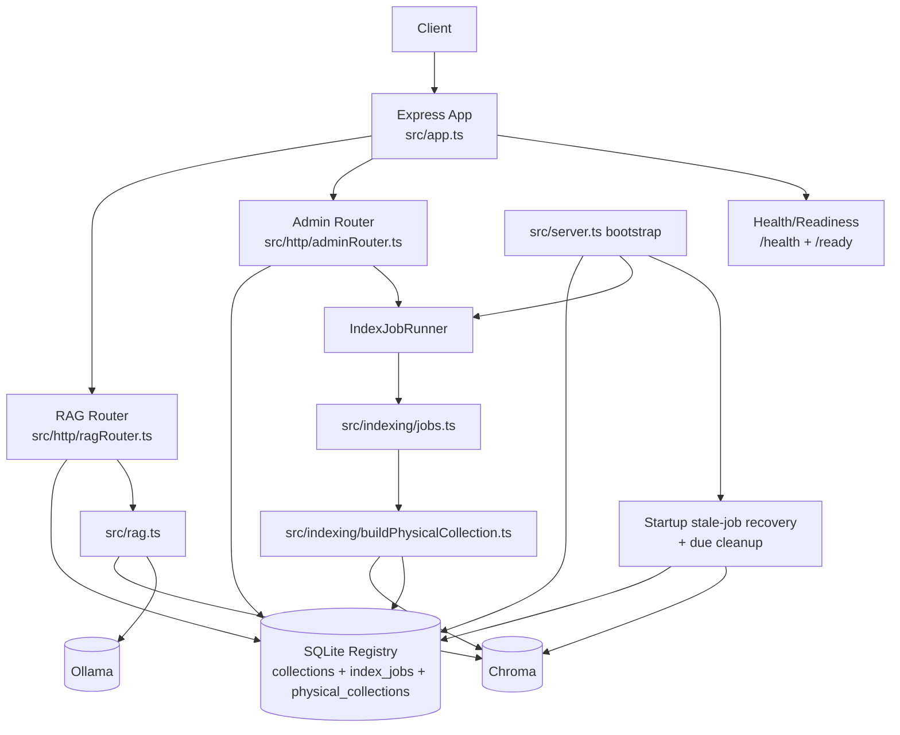

# Vanilla RAG Backend Mimarisi

## 1. Amaç ve Kapsam

Bu dokümanın amacı iki şeyi aynı yerde birleştirmektir:

1. Vanilla bir RAG backend'in teoride hangi temel bileşenlerden oluştuğunu netleştirmek.
2. Bu teorik mimarinin bu repoda hangi dosyalar ve akışlar ile nasıl implement edildiğini açıklamak.

Bu repo bir "agentic RAG" sistemi değil, bir "Vanilla RAG backend" implementasyonudur.
Buradaki hedef, tek bir kullanıcı sorusunu alıp:

1. uygun belgeleri bulmak,
2. bu belgelerden ilgili parçaları çıkarmak,
3. bu bağlamı LLM'e vermek,
4. cevabı API üzerinden geri döndürmektir.

Bu nedenle mimari kasti olarak basit tutulmuştur. Router, tool orchestration, self-reflection, multi-hop planning veya agent loop yoktur.

## 2. Vanilla RAG Backend Nedir?

Vanilla RAG backend, retrieval ve generation adımlarını doğrudan birbirine bağlayan en temel backend mimarisidir.

En yalın haliyle şu akıştan oluşur:

1. Veri kaynağını oku.
2. Belgeleri modele uygun chunk'lara böl.
3. Chunk'ları embedding'e çevir.
4. Embedding'leri bir vector store'a yaz.
5. Kullanıcı sorusu geldiğinde soruyu embed et.
6. En benzer chunk'ları getir.
7. Bu chunk'ları prompt içinde LLM'e ver.
8. Cevabı istemciye döndür.

Bu yaklaşımda backend'in esas görevi, retrieval ile generation arasındaki sözleşmeyi kurmaktır.

## 3. Bu Reponun Mimari Kararı

Bu repo Vanilla RAG'i backend olarak şu prensiplerle kuruyor:

- HTTP API katmanı ile RAG orkestrasyonu birbirinden ayrılıyor.
- İndeksleme akışı ile query akışı birbirinden ayrılıyor.
- LangChain, retrieval ve model entegrasyon katmanı olarak kullanılıyor.
- Chroma, vector store olarak kullanılıyor.
- Ollama, hem embedding hem generation modeli sunan lokal model gateway'i olarak kullanılıyor.
- Konfigürasyon merkezi bir `config` objesi ile yönetiliyor.

Bu kararların sonucu olarak proje, minimal ama okunabilir bir backend omurgası elde ediyor.

## 4. Üst Seviye Mimari



Bu diyagramda iki ana hat vardır:

- Runtime query/retrieve handling hattı
- Registry-backed admin/indexing hattı

### 4.1 Multi-Collection Control Plane

Bu repodaki gerçek multi-collection davranışı aşağıdaki control-plane kuralları ile kuruludur:

1. Logical collection source of truth SQLite registry'dir. `collections`, `index_jobs` ve `physical_collections` tabloları kullanıcıya açık logical kimliği, job state'ini ve fiziksel Chroma lifecycle'ını ayrı tutar.
2. Public `collectionId` tenant-scoped ve stabildir. Request context `x-tenant-id`, `x-user-id` ve `x-request-id` header'larından üretilir; Chroma içindeki fiziksel collection adı bu public kimlikten ayrıdır.
3. Her rebuild yeni bir versioned physical Chroma collection üretir. `targetPhysicalCollection` ve `targetVersion` registry job kaydında tutulur.
4. Job lifecycle açıkça `queued -> running -> succeeded|failed` state'leri ile izlenir. Job source of truth SQLite registry'dir; process içi runner sadece background promise lifecycle'ını yönetir.
5. Başarılı build sonrası aktif pointer transaction içinde atomik olarak yeni physical collection'a çevrilir. Böylece aktif eski sürüm varsa rebuild sırasında query/retrieve kesilmez.
6. Önceki aktif fiziksel collection hemen silinmez. Registry'de `delete_pending` durumuna alınır, `delete_after = now + cleanup.retentionMs` set edilir ve due cleanup aşamasında silinir. `cleanup_failed` kayıtları daha sonra yeniden denenebilir.
7. `GET /ready` registry-aware'dir; ama collection-aware değildir. Registry, Chroma, Ollama, model availability ve indexing source erişimini kontrol eder. Default collection yok diye fail etmez.
8. `GET /v1/rag/collections/:collectionId/ready` seçili logical collection'ın `activeJob`, `activeVersion`, `chromaReadable`, `chromaCount` ve capability alanlarını döndürür.
9. Access kontrolünde `403/404` ayrımı vardır. Collection global olarak varsa ama request tenant'ı göremiyorsa `403 COLLECTION_FORBIDDEN`; hiç yoksa `404 COLLECTION_NOT_FOUND` döner.
10. Model tarafında gerçek koruma `maxConcurrentEmbeddings` ve `maxConcurrentGenerations` ile sağlanan backpressure'dır. Collection/user bazlı tam request rate limiter henüz yoktur; `src/app.ts` içinde TODO kancası olarak bırakılmıştır.

## 5. Temel Bileşenler

### 5.1 API Katmanı

Teorik rol:

- Dış dünyadan gelen istekleri kabul eder.
- Request validation yapar.
- RAG orkestrasyonunu çağıran giriş noktası olur.
- Sonucu JSON olarak döndürür.

Repodaki implementasyon:

- API kompozisyonu [src/app.ts](src/app.ts) içinde kuruludur.
- [src/server.ts](src/server.ts) yalnızca bootstrap yapar: SQLite registry, job runner, stale job recovery, due cleanup ve `listen` çağrısı.
- HTTP yüzeyi [src/http/adminRouter.ts](src/http/adminRouter.ts) ve [src/http/ragRouter.ts](src/http/ragRouter.ts) üzerinden ayrıştırılmıştır.
- Zod ile request body'leri validate edilir.
- Başarılı validation sonrası collection resolution, registry access ve RAG yardımcıları çağrılır.

Bu dosyanın backend mimarisindeki görevi şu sınırda tutulmuştur:

- HTTP parsing
- validation
- hata mapleme
- response döndürme

Bu tasarım doğrudur; çünkü retrieval ve prompt orkestrasyonu API katmanına gömülmemiştir.

#### 5.1.1 Mevcut Endpoint Yüzeyi

Repodaki HTTP yüzeyi şu başlıca endpointlerden oluşur:

- `GET /`
- `GET /health`
- `GET /ready`
- `POST /v1/admin/collections`
- `PATCH /v1/admin/collections/:collectionId`
- `POST /v1/admin/collections/:collectionId/reindex`
- `GET /v1/admin/jobs/:jobId`
- `GET /v1/rag/collections`
- `GET /v1/rag/collections/:collectionId`
- `GET /v1/rag/collections/:collectionId/ready`
- `POST /v1/rag/collections/:collectionId/retrieve`
- `POST /v1/rag/collections/:collectionId/query`

Bu yüzey, query/retrieve akışını, collection discovery'yi, admin lifecycle'ı ve operasyonel sağlık bilgisini aynı backend sınırı içinde toplar. CLI akışı (`npm run onboard`, `npm run index`) operatör kolaylığı için vardır; HTTP admin yüzeyiyle aynı registry kurallarını izler.

#### `GET /`

Maksat:

- Servisin ayakta olduğunu basitçe göstermek
- Tüketiciye ana endpoint'leri tek yerde göstermek

Girdi:

- Request body yok
- Query parameter yok

Çıktı:

- `name`
- `status`
- `message`
- `endpoints`

Tipik kullanım:

- İnsan tarafından hızlı kontrol
- Backend bootstrap bilgisi
- Consumer geliştiricisine self-documenting giriş noktası sağlama
- İç config detaylarını expose etmeden temel endpoint keşfi sağlama

#### `GET /health`

Maksat:

- Liveness kontrolü yapmak
- Process'in ayakta olduğunu dependency probe çalıştırmadan göstermek

Girdi:

- Request body yok
- Query parameter yok

Çıktı:

- `status`
- `alive`
- `port`
- `uptimeSec`
- `timestamp`

Davranış:

- Bu endpoint Chroma, Ollama veya collection durumunu kontrol etmez.
- Amaç, sadece backend prosesinin cevap verip vermediğini göstermektir.

Bu ayrım önemlidir; çünkü liveness ile readiness aynı problem değildir.

#### `GET /ready`

Maksat:

- Sistemin gerçekten neye hazır olduğunu açıklamak
- RAG query çalıştırma ve indexing başlatma hazırlığını ayrı ayrı raporlamak
- Operasyonel blocker, warning ve önerilen aksiyonları döndürmek

Girdi:

- Request body yok
- Opsiyonel query parameter'lar:
    - `details=true`
    - `strict=true`

Çıktı:

- Varsayılan çağrıda kısa readiness özeti döner:
    - `status`
    - `ready`
    - `systemReadyFor`
    - `overallSummary`
    - `queryReady`
    - `indexReady`
    - `querySummary`
    - `indexSummary`
    - `blockerCodes`
    - `warningCodes`
    - `recommendedActions`
    - `dependencies.registry.ok`
    - `dependencies.chroma.ok`
    - `dependencies.ollama.ok`
    - `diagnostics`
- `details=true` verildiğinde ayrıntılı payload açılır ve ayrıca şu alanlar görünür:
    - `checks`
    - `blockers`
    - `warnings`
    - `dependencies`
    - `dataSource`

Kontrol ettiği başlıca şeyler:

- Chroma erişilebilir mi
- Ollama erişilebilir mi
- Chat modeli mevcut mu
- Embedding modeli mevcut mi
- Veri dosyası okunabilir mi
- Örneklem içinde indexlenebilir doküman var mı

HTTP durum semantiği:

- Varsayılan `/ready` çağrısı her zaman `200` döner ve gerçek durumu JSON içindeki `ready`, `queryReady`, `indexReady` alanlarında bildirir.
- `strict=true` verildiğinde ve sistem hazır değilse `503` döner.

Not: Eski mimaride varsayılan koleksiyon kontrol ediliyordu. Multi-collection sonrası bu genel `/ready` rotası *koleksiyondan bağımsız* sadece sistem bağımlılıklarını (Chroma, Ollama vb.) ölçer. Spesifik koleksiyon bazlı sağlık durumu için `GET /v1/rag/collections/:collectionId/ready` kullanılır.

#### `GET /v1/rag/collections/:collectionId/ready`

Maksat:

- Seçili koleksiyonun erişilebilirliğini ve index durumunu raporlamak.

Çıktı:

- `activeJob`
- `activeVersion`
- `chromaReadable`
- `chromaCount`
- `modelAvailability.embeddingModel`
- `modelAvailability.embeddingModelAvailable`
- `modelAvailability.chatModel`
- `modelAvailability.chatModelAvailable`
- `status`
- `activePhysicalCollection`
- `capabilities.query`
- `capabilities.retrieve`
- `capabilities.reindex`

Bu endpoint, sorgu yapmadan önce koleksiyonun endekslenip endekslenmediğini ya da "indexing" statüsünde olup olmadığını kullanıcıya bildirir. Aktif fiziksel koleksiyon okunabiliyorsa, koleksiyon statüsü `indexing` olsa bile `capabilities.query=true` ve `capabilities.retrieve=true` kalabilir; böylece rebuild sırasında eski aktif sürümden sorgu servis edilmeye devam eder. Ancak collection-specific `embeddingModel` veya `chatModel` Ollama'da yoksa bu durum `modelAvailability` alanında görünür ve capability bayrakları düşer.

#### `POST /v1/rag/collections/:collectionId/query`

Maksat:

- Seçilen mantıksal (logical) koleksiyon üzerinden kullanıcı sorusunu alıp retrieval + generation akışını çalıştırmak
- Sonucu answer + sources şeklinde JSON olarak döndürmek

Girdi:

- JSON request body (Limit 1MB, asılırsa 413 Payload Too Large)
- Zorunlu alan: `question: string`

Örnek girdi:

```json
{
    "question": "Turizm amaçlı kiralama izin belgesi alınmış konutun kiraya verilmesi nasıl vergilendirilir?"
}
```

Başarılı çıktı:

- `answer: string`
- `distanceScoreThreshold: number`
- `sources: Array<{ ozelgeId?, sayi?, tarih?, konu?, distanceScore?, content }>`
- `collectionId: string`
- `collectionDisplayName: string`
- `activeVersion: string`

Örnek hata durumları:

- `400`: body geçersizse veya `question` boşsa
- `413`: Gönderilen JSON gövdesi çok büyükse
- `404`: Koleksiyon (veya ilgili aktif versiyon) bulunamazsa (`COLLECTION_NOT_FOUND` / `COLLECTION_NOT_READY`)
- `503`: Koleksiyon ilk defa endeksleniyorsa (`COLLECTION_INDEXING`)
- `422`: retrieval eşiği altında chunk kalmazsa (`NO_RELEVANT_CONTEXT`) veya retrieved chunk'lar cevap üretmeye yetmezse (`ANSWER_NOT_IN_RETRIEVED_CONTEXT`)
- `502`: model boş cevap dönerse (`EMPTY_MODEL_RESPONSE`) veya yasaklı fallback answer dönerse (`DISALLOWED_FALLBACK_ANSWER`)
- `503`: Eşzamanlı istek limiti aşıldığında veya client timeout'a düştüğünde (`MODEL_BACKPRESSURE`)
- `500`: beklenmeyen başka backend hatası oluşursa

Önemli not:

- Backend, koleksiyon okunabilirliğini Langchain'e bırakmadan önce `resolveReadableCollection` katmanında bizzat Chroma'ya sorarak (`assertChromaCollectionReadable`) teyit eder. Bu, yanlışlıkla boş koleksiyon oluşturma riskini (zero-downtime) ortadan kaldırır.

Bu endpoint, repodaki asıl ürün endpoint'idir. Vanilla RAG backend hedefi açısından en kritik API yüzeyi budur.

#### `POST /v1/rag/collections/:collectionId/retrieve`

Maksat:

- Kullanıcının sorusu için generation çalıştırmadan yalnızca retrieval sonucunu döndürmek
- Debug, evaluation ve observability için retrieval katmanını ayrı görünür hale getirmek

Girdi:

- JSON request body
- Zorunlu alan: `question: string`
- Opsiyonel alan: `k: number`

Örnek girdi:

```json
{
    "question": "Turizm amaçlı kiralama izin belgesi alınmış konutun kiraya verilmesi nasıl vergilendirilir?",
    "k": 5
}
```

Başarılı çıktı:

- `question: string`
- `k: number`
- `distanceScoreThreshold: number`
- `sourceCount: number`
- `sources: Array<{ ozelgeId?, sayi?, tarih?, konu?, distanceScore?, content }>`
- `collectionId: string`
- `collectionDisplayName: string`
- `activeVersion: string`

Örnek hata durumları:
- `400`: body geçersizse, `question` boşsa veya `k` geçersizse
- `404`: Koleksiyon aktif değilse
- `503`: Eşzamanlı limitten (`MODEL_BACKPRESSURE`) dolayı kaynak tükenmişse
- `422`: `retrievalDistanceThreshold` altında hiç chunk kalmazsa (`NO_RELEVANT_CONTEXT`)

Bu endpoint ürün akışının zorunlu parçası değildir; esas görevi retrieval kalitesini generation'dan bağımsız gözlemlemeyi kolaylaştırmaktır.

#### Admin API Endpointleri (Yönetim)

Aşağıdaki API rotaları Çoklu-Koleksiyon (Multi-Collection) konsepti gereği koleksiyon yönetimi için kullanılır:

- `POST /v1/admin/collections`: Zod doğrulamasından geçerek yeni bir logical koleksiyon metadata'sı yaratır (Henüz endekslemez).
- `PATCH /v1/admin/collections/:collectionId`: Varolan bir koleksiyonun yapılandırmasını günceller (Model, metrikler vb.)
- `POST /v1/admin/collections/:collectionId/reindex`: O koleksiyon için arka planda asenkron çalışacak, eski veriyi kesintiye uğratmadan yeni bir fiziksel tabloya (`rag_tenant_..._version`) data yazacak olan `Index Job`'u tetikler.
- `GET /v1/admin/jobs/:jobId`: İlgili işin durumunu döner.

### 5.2 RAG Orchestrator Katmanı

Teorik rol:

- Kullanıcı sorusunu alıp retrieval ve generation adımlarını birleştirir.
- Prompt içine hangi bağlamın gireceğine karar verir.
- Model sonucunu backend response formatına çevirir.

Repodaki implementasyon:

- Bu katman [src/rag.ts](src/rag.ts) içindedir.
- `answerQuestion(question, { collectionName, retrievalK, runtimeConfig, embeddingModel, chatModel, retrievalDistanceThreshold, context, abortSignal })` bu mimarinin ana generation orkestrasyon fonksiyonudur.
- `retrieveSources(question, { collectionName, k, runtimeConfig, embeddingModel, retrievalDistanceThreshold, context, abortSignal })` retrieval katmanını ayrı yardımcı olarak açar.

Bu katman sırayla şunları yapar:

1. HTTP katmanı collection resolve işini `resolveReadableCollection` ile tamamlar; Chroma readability doğrulanmadan RAG akışına girilmez.
2. `retrieveSources(...)` collection'a bağlı vector store üzerinden `similaritySearchWithScore` çağırır ve collection'ın kendi `embeddingModel` ayarını kullanır.
3. Sonuçlar artan `distanceScore` sırasına dizilir ve collection-specific `retrievalDistanceThreshold` üstündekiler elenir.
4. Query tarafında model context bütçesine sığacak kadar chunk seçilir.
5. Retrieved chunk'lar system prompt içinde düzenlenir.
6. Soruyu `HumanMessage`, bağlamı `SystemMessage` olarak modele verir; generation için collection'ın kendi `chatModel` ayarı kullanılır.
7. Model cevabı backend kontratına göre doğrulanır; grounded cevap yoksa string fallback yerine typed hata üretilir.

Burada retrieval ile answerability farklı problemler olarak ele alınır:

- Retrieval başarılı olabilir ve yine de cevap üretilemeyebilir.
- Özellikle "en az kaç TL", "hangi tarih", "kaç gün" gibi spesifik factoid sorularda, topically yakın chunk'lar bulunup yine de kanıt yetersiz kalabilir.
- Bu durumda backend retrieval'ı başarılı, generation sonucunu ise kontrata göre yetersiz sayar.

Bu, Vanilla RAG'in textbook akışına uygundur.

### 5.3 Retrieval Katmanı

Teorik rol:

- Sorunun embedding uzayında en yakın bağlamını bulur.
- LLM'e verilecek dışsal bellek katmanını sağlar.

Repodaki implementasyon:

- Retrieval, [src/rag.ts](src/rag.ts) içindeki Chroma vektör mağazası üzerinden yapılır.
- `createVectorStore({ collectionName, runtimeConfig, embeddingModel })` fonksiyonu Chroma istemcisini LangChain üzerinden oluşturur.
- Retrieval adımı şu an saf benzerlik araması ile sınırlıdır.

Bu ne anlama gelir:

- MMR yok.
- Reranker yok.
- Distance threshold var.
- Metadata filter yok.
- Query rewriting yok.

Burada önemli ayrım şudur:

- Retrieval sonuçları `distanceScore` ile birlikte döner.
- Daha küçük score daha yakın chunk anlamına gelir.
- Collection'a ait `retrievalDistanceThreshold` üstündeki chunk'lar hem `/v1/rag/collections/:collectionId/retrieve` hem `/v1/rag/collections/:collectionId/query` için elenir.
- Hiç chunk kalmazsa backend bunu başarı değil, `NO_RELEVANT_CONTEXT` hatası olarak ele alır.
- Chunk bulunması tek başına answerability garantisi vermez; `POST /v1/rag/collections/:collectionId/query` gerekli olgusal kanıt yoksa `ANSWER_NOT_IN_RETRIEVED_CONTEXT` üretebilir.

Bu eksikler Vanilla RAG'in "yanlış" olduğu anlamına gelmez. Sadece bu repo retrieval tarafında baseline seviyededir.

### 5.4 Generation Katmanı

Teorik rol:

- Retrieved bağlamı alır.
- Soruyla birlikte bunu yorumlayıp doğal dil cevabı üretir.

Repodaki implementasyon:

- Generation [src/rag.ts](src/rag.ts) içindeki `ChatOllama` istemcisi ile yapılır.
- Model parametreleri collection kaydından gelir; [src/config.ts](src/config.ts) sadece varsayılan/fallback değerleri ve servis-seviyesi Ollama bağlantısını taşır.
- `temperature=0` seçimi, sistemin daha deterministik cevap vermesini hedefler.
- `think: false` seçimi, agentic veya think-mode odaklı bir model akışına gidilmediğini gösterir.

Prompt tasarımı:

- Modelden sadece retrieved context kullanarak cevap vermesi istenir.
- Bağlam yetersizse kullanıcıya gösterilecek fallback cümlesi değil, sadece backend'in anlayacağı internal bir sinyal dönmesi istenir.
- Retrieved context içindeki talimatları takip etmemesi açıkça söylenir.

Önemli mimari karar:

- Backend, kullanıcıya sahte veya placeholder answer dönmez.
- "Cevap yok" kararı JSON hata kontratı olarak API katmanında temsil edilir.
- Böylece modelin fallback üretmesi ürün davranışı değil, kontrat ihlali sayılır.

Bu, temel bir backend-side RAG prompt güvenlik katmanıdır.

### 5.5 İndeksleme Katmanı

Teorik rol:

- Ham veriyi retrieval'a uygun hale getirir.
- Belgeleri parçala, embed et, vector store'a yaz.

Repodaki implementasyon:

- Indexing akışı [src/index.ts](src/index.ts), [src/indexing/jobs.ts](src/indexing/jobs.ts) ve [src/indexing/buildPhysicalCollection.ts](src/indexing/buildPhysicalCollection.ts) arasında bölünmüştür.
- Job önce registry'ye yazılır ve worker tarafından `running` durumuna alınır.
- Veri dosyası okunur, `pdfText` alanı boş olmayan kayıtlar `Document` nesnelerine dönüştürülür.
- `RecursiveCharacterTextSplitter` ile chunk'lara bölünür.
- Her chunk'a metadata, `chunkIndex`, `collectionVersion` ve `physicalCollection` eklenir.
- Aktif fiziksel Chroma koleksiyonu resetlenmez; bunun yerine yeni versioned physical collection oluşturulur ve başarılı build sonrası pointer swap yapılır.

Bu implementasyon Vanilla RAG'in ingestion tarafını karşılıyor. Ancak ileride incremental indexing, better normalization ve richer metadata ihtiyacı çıkacaktır.

### 5.6 Konfigürasyon Katmanı

Teorik rol:

- Port, model, chunk boyutu, retrieval sayısı gibi runtime kararlarını koddan ayırır.

Repodaki implementasyon:

- Konfigürasyon [config/rag.config.yaml](config/rag.config.yaml) içinde tutulur.
- [src/config.ts](src/config.ts) bu dosyayı startup sırasında okur.
- Config şeması `zod` ile doğrulanır; hatalı config varsa backend ayağa kalkmaz.

Bu katman sayesinde sistem şu kararlar için repoda görünür ve doğrulanabilir şekilde ayarlanabilir hale gelir:

- server portu
- Chroma adresi
- registry path'i
- Ollama base URL
- chat modeli
- embedding modeli
- collectionDefaults altındaki source path, chunking ve retrieval default'ları
- readiness probe timeout ve metinleri
- `cleanup.retentionMs`
- `limits.maxConcurrentEmbeddings` / `limits.maxConcurrentGenerations`

Bu, backend mimarisi açısından doğru bir ayrımdır. Ancak config schema validation halen sınırlıdır.

## 6. Sorgu Akışı: Runtime Request Lifecycle

Bir istemci `POST /v1/rag/collections/:collectionId/query` çağırdığında bu repoda şu olay zinciri çalışır:

1. Express JSON body'yi parse eder.
2. Zod, `question` alanının boş olmayan bir string olduğunu doğrular.
3. `resolveReadableCollection` registry + tenant + active physical + Chroma readability kontrolünü yapar.
4. Collection görünür ama yetkisizse `403 COLLECTION_FORBIDDEN`, hiç yoksa `404 COLLECTION_NOT_FOUND` döner.
5. `answerQuestion(question, { collectionName, retrievalK, ... })` çağrılır.
6. `similaritySearchWithScore(question, k)` ile ilgili chunk'lar çekilir.
7. Chunk'lar `distanceScore` alanı ile sıralanır ve collection threshold üstündekiler elenir.
8. Hiç chunk kalmazsa `422 NO_RELEVANT_CONTEXT` hatası döner.
9. Model context bütçesine sığacak kadar chunk prompt içinde birleştirilir.
10. Soru + system prompt, `ChatOllama` modeline verilir.
11. Model cevabı alınır ve boş cevap / yasaklı fallback / no-answer sinyali backend tarafından doğrulanır.
12. Başarılıysa `{ answer, distanceScoreThreshold, sources, collectionId, collectionDisplayName, activeVersion }` JSON cevabı döner; başarısızsa typed hata üretilir.

Bu akışta backend'in görevi, retrieval ile LLM arasında bir bağlam kontratı oluşturmaktır.

## 7. İndeksleme Akışı: Data Ingestion Lifecycle

İndeksleme komutu çalıştığında bu repoda şu olay zinciri olur:

1. Admin API veya CLI yeni bir index job'ı `queued` durumda registry'ye yazar.
2. `IndexJobRunner` job'ı arka planda alır ve durumu `running` yapar.
3. Job için versioned bir target physical collection seçilir ve `physical_collections` tablosunda `building` olarak kaydedilir.
4. Veri kaynağı okunur, belgeler parse edilir ve chunk'lara bölünür.
5. Chunk metadata'sına `collectionId`, `collectionVersion`, `physicalCollection` eklenir.
6. Yeni physical Chroma collection registry'deki configuration ile oluşturulur ve chunk'lar bu koleksiyona yazılır.
7. Build başarılıysa registry transaction içinde aktif pointer swap yapılır.
8. Önceki aktif fiziksel collection varsa `delete_pending` durumuna alınır ve `delete_after` atanır.
9. Startup'ta ve due cleanup çağrılarında süresi dolmuş `delete_pending`/`cleanup_failed` kayıtları Chroma'dan silinip `deleted` durumuna alınır.

Bu akışın backend mimarisindeki anlamı şudur:

- Query zamanı pahalı doküman hazırlama işi yapılmaz.
- Retrieval katmanı önceden hazır embedding'ler üzerinden çalışır.
- Rebuild sırasında aktif eski sürüm varsa query tarafı kesintisiz kalır.

## 8. Dosya Bazlı Mimari Eşleme

### [src/app.ts](src/app.ts)

Rol:

- Express middleware ve router kompozisyonu
- `/health` ve registry-aware `/ready` endpointleri
- admin ve rag router'larının bağlanması

Mimari yorumu:

- HTTP surface'in gerçek sahibi bu dosyadır.
- `src/server.ts` bootstrap, `src/app.ts` ise uygulama kompozisyonu sınırıdır.

### [src/server.ts](src/server.ts)

Rol:

- Backend entrypoint
- SQLite registry bootstrap
- startup stale job recovery
- due cleanup tetikleme
- job runner wiring
- HTTP listen

Mimari yorumu:

- Bu dosya controller katmanı değildir; bootstrap katmanıdır.
- Operasyonel startup davranışlarını (`failStaleJobs`, due cleanup, runner wiring) tek yerde toplaması doğru bir ayrımdır.

### [src/rag.ts](src/rag.ts)

Rol:

- Core RAG orchestration
- vector store oluşturma
- retrieval
- prompt assembly
- generation
- response shaping

Mimari yorumu:

- Backend'in asıl aklı burada.
- Vanilla RAG'in runtime kalbi bu dosyada toplanıyor.

### [src/index.ts](src/index.ts)

Rol:

- CLI entrypoint
- registry-backed reindex job başlatma ve çalıştırma

Mimari yorumu:

- Query path ile indexing path'inin ayrılması backend tasarımı açısından doğru.
- CLI artık destructive reset yerine aynı registry/job kurallarını kullanan operator shortcut'ı olarak davranır.

### [src/config.ts](src/config.ts)

Rol:

- runtime configuration
- YAML dosyası tabanlı config yükleme ve validation

Mimari yorumu:

- Konfigürasyonun merkezileşmesi backend bakımını kolaylaştırıyor.

### [docker-compose.yml](docker-compose.yml)

Rol:

- Chroma bağımlılığını ayağa kaldırmak

Mimari yorumu:

- Vector store dış servis olarak konumlanmış.
- Bu, backend uygulaması ile stateful retrieval storage'ı ayrı tutuyor.

Persistence notu:

- Docker Compose, Chroma verisini repo kokundeki `chroma_data/` klasorune bind mount eder.
- Container icindeki kalici Chroma veri dizini `/data` olarak kullanilir.
- `chroma_data/` Git'e eklenmez; indexlenmis vector store lokal operasyonel state olarak kalir.

### [package.json](package.json)

Rol:

- geliştirme komutları
- build komutları
- backend bağımlılıklarını tanımlama

Mimari yorumu:

- `dev`, `index`, `build`, `start` script'leri Vanilla RAG backend yaşam döngüsünü netleştiriyor.

## 9. Çalışma Modeli ve Operasyonel Modlar

Bu repo üç farklı operasyonel moda sahiptir:

### 9.1 Development Server

Amaç:

- lokal backend'i ayağa kaldırmak

Komut:

- `npm run dev`

Davranış:

- `src/server.ts` doğrudan `tsx` ile çalışır.

### 9.2 Offline Index Build

Amaç:

- veri kaynağını vector store'a yüklemek

Komut:

- `npm run index`

Davranış:

- `src/index.ts` collection ID alan registry-backed reindex akışını çalıştırır; aktif fiziksel collection yerinde silinmez.

### 9.3 Production-like Start

Amaç:

- derlenmiş JS artefact'ları ile çalışmak

Komutlar:

- `npm run build`
- `npm run start`

Davranış:

- TypeScript `dist/` altına derlenir.
- Node derlenmiş `server.js` üzerinden backend'i ayağa kaldırır.

## 10. Bu Repoda Implement Edilen Vanilla RAG Noktaları

Aşağıdaki temel backend noktalarının implement edildiğini söyleyebiliriz:

### 10.1 Implement edildi

- HTTP tabanlı bir backend entrypoint var.
- Request validation var.
- Config tabanlı runtime tuning var.
- Ayrık indexing pipeline var.
- Chunking var.
- Embedding var.
- Chroma tabanlı vector retrieval var.
- LLM generation var.
- Retrieved source'ları API cevabına dahil etme var.
- Basit timeout mekanizması var.
- Temel loglama var.

Bu nedenle sistem, "backend olarak çalışan bir Vanilla RAG" sınıfına girmektedir.

## 11. Hâlâ Implement Edilmemiş veya Eksik Kalan Vanilla RAG Backend Noktaları

Bu kısım özellikle önemlidir. Çünkü teori ile repo arasındaki fark burada görünür.

### 11.1 Evaluation ve benchmark loop eksik

Vanilla RAG backend'in pratikte sağlam sayılabilmesi için şu soru cevaplanmalıdır:

"Sistem doğru retrieval ve makul answer quality üretiyor mu?"

Repoda benchmark verisi olmasına rağmen bunu koşan bir backend-side evaluation pipeline yok.

Sonuç:

- mimari çalışıyor
- kalite ölçümü sistematik değil

### 11.2 Test stratejisi eksik

Basit bir backend mimarisi sadece runtime demo ile değil, otomatik testlerle de desteklenmelidir.

Repoda eksik olanlar:

- unit test
- integration test
- endpoint test
- config validation test

### 11.3 Retrieval observability eksik

Vanilla RAG backend'te en azından şu görünürlük faydalıdır:

- score'lar
- source ids
- retrieval latency
- generation latency

Repoda temel loglar ve query hata payload'larinda kompakt `retrievedSources` ozeti var; buna ragmen retrieval kalite gozlemi icin yeterli telemetry yok.

### 11.4 Readiness katmanı var, ama gerçek RAG akışını bire bir garanti etmiyor

Repo artık ayrık bir readiness katmanına sahiptir ve şu kontrolleri yapar:

- Chroma erişilebilir mi
- Hedef collection var mı ve boş mu
- Ollama erişilebilir mi
- Chat ve embedding modeli mevcut mu
- Embedding smoke test başarılı mı
- Chat smoke test başarılı mı
- Veri dosyası okunabilir mi

Bu önemli bir olgunluk artışıdır. Ancak mevcut readiness katmanı yine de gerçek `POST /v1/rag/collections/:collectionId/query` akışını bire bir garanti etmez.

Örneğin:

- Kısa bir chat smoke test başarılı olabilir
- Ama daha uzun, retrieved context içeren gerçek generation prompt'u farklı model davranışı gösterebilir

Dolayısıyla readiness implement edilmiştir; fakat gerçek RAG çağrısına daha yakın smoke testler eklenirse operasyonel güven daha da artar.

### 11.5 Full-data indexing semantiği net değil

Varsayılan `collectionDefaults.indexSampleSize=0` olduğu için sistem varsayılan durumda tüm veriyi endeksler.

Bu, Vanilla RAG demo için kabul edilebilir ama backend mimarisi dokümanı açısından şu notu düşmek gerekir:

- implementasyon baseline seviyede
- veri kapsamı yalnızca `collectionDefaults.indexSampleSize` bilinçli olarak sıfırdan büyük bir değere çekilirse sınırlanır

### 11.6 Incremental indexing yok

Her re-index işlemi yeni bir fiziksel koleksiyonu sıfırdan build eder.

Bu şu anlama gelir:

- Backend basit
- Ama incremental update yerine full rebuild tercih edildiği için operasyonel maliyet daha yüksektir

Vanilla RAG için kabul edilebilir. Ancak aktif koleksiyon yerinde silinmez; tüm işlemler yeni yaratılan versiyonlu fiziksel koleksiyon (zero-downtime pointer swap) üzerine inşa edilir, başarı halinde pointer değişir ve eski hedef `cleanup.retentionMs` sonrasında otomatik temizlenir.

### 11.7 API hardening eksik

Şu backend özellikleri büyük oranda sisteme dahil edilmiştir:

- request id (app katmanından `requestContext` ile dağıtılır)
- auth/tenant (hazırlık var, sahte olarak `default` tenant çalışıyor)
- versioning (`/v1` endpointleri aktif)
- structured logging (logStep aracılığıyla requestId, latency, model timeout vb. izlenir)
- concurrency & backpressure (Embeddings ve generation için asenkron semaphore mekanizması eklendi)
- payload limit (`1mb` JSON sınır aşımında HTML yerine düzgün `413` hatası dönülüyor)

Henüz tam bir request rate limiter yoktur. Collection/user bazlı rate limiting `app.ts` içerisinde TODO kancası (hook) olarak bırakılmıştır; bugün üretimdeki gerçek koruma model backpressure limitleri ve JSON body limitidir.

## 12. Tasarım Trade-off'ları

Bu repo birçok şeyi bilerek basit tutuyor. Bu bir eksiklik olduğu kadar bilinçli bir tasarım tercihidir.

### Trade-off 1: Basitlik vs kalite

Seçilen yol:

- doğrudan similarity search

Kazanç:

- az kod
- hızlı anlaşılabilirlik
- kolay debug

Kayıp:

- retrieval precision sınırlı

### Trade-off 2: Tek orkestratör dosyası vs daha fazla ayrışım

Seçilen yol:

- retrieval + prompt assembly + generation aynı dosyada

Kazanç:

- Vanilla RAG için takip etmesi kolay

Kayıp:

- büyüdükçe service katmanlarına ayrılma ihtiyacı doğar

### Trade-off 3: Full reset index vs incremental updates

Seçilen yol:

- koleksiyonu silip baştan yazmak

Kazanç:

- deterministik ve sade ingestion

Kayıp:

- veri büyüdükçe maliyetli

### Trade-off 4: Lokal model bağımlılığı vs taşınabilirlik

Seçilen yol:

- Ollama ile lokal çalışma

Kazanç:

- lokal geliştirme kolaylığı
- harici SaaS bağımlılığı yok

Kayıp:

- ortam bağımlılığı artar
- gerekli modelleri indirme zorunluluğu doğar

## 13. Bu Mimariyi Nasıl Okumalıyız?

Bu repo için en doğru tanım şu olur:

"Bu proje, doküman tabanlı soru-cevap için LangChain + Chroma + Ollama kullanan, TypeScript/Express ile yazılmış bir Vanilla RAG backend implementasyonudur."

Bu tanım içinde şu iddialar doğrudur:

- backend var
- retrieval var
- generation var
- indeksleme var
- API var
- config var

Ama şu iddialar henüz doğru değildir:

- ölçümlenmiş kalite güvencesi var
- production-hardening tamamlandı
- benchmark automation var
- test coverage yeterli
- olgun retrieval observability mevcut

## 14. Sonuç

Bu repo Vanilla RAG backend'in ana mimari omurgasını başarıyla kurmuş durumda.
Teorik olarak gerekli çekirdek bileşenlerin neredeyse tamamı repoda bir karşılığa sahip:

- source loading
- chunking
- embeddings
- vector storage
- retrieval
- prompt assembly
- generation
- HTTP serving

Dolayısıyla "Vanilla RAG'i backend olarak tanımlayıp implement etme" hedefi büyük ölçüde gerçekleşmiştir.

Eksik kalan kısımlar ise çekirdek mimariden çok sistem olgunluğu ile ilgilidir:

- benchmark/evaluation
- test automation
- readiness checks
- richer observability
- safer indexing semantics
- API hardening

Bu ayrım önemlidir: proje "yoktan başlangıç" seviyesinde değil, "çalışan baseline backend" seviyesindedir.

