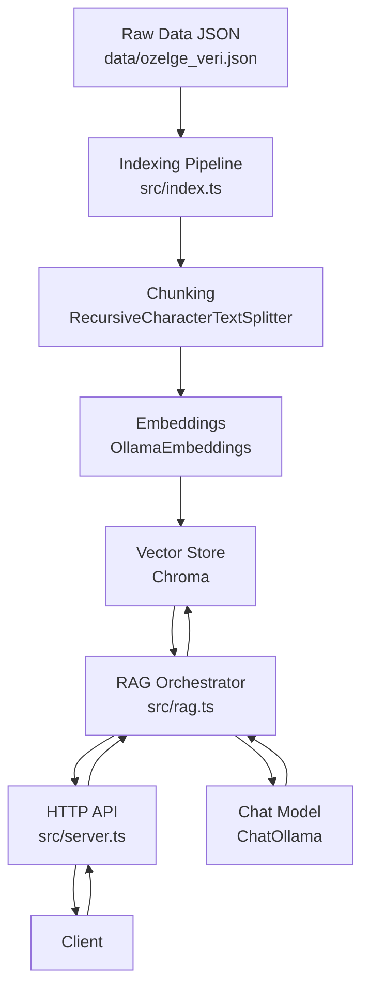

# Vanilla RAG Backend Mimarisi

## 1. Amaç ve Kapsam

Bu dokümanın amacı iki şeyi aynı yerde birleştirmektir:

1. Vanilla bir RAG backend'in teoride hangi temel bileşenlerden oluştuğunu netleştirmek.
2. Bu teorik mimarinin bu repoda hangi dosyalar ve akışlar ile nasıl implement edildiğini açıklamak.

Bu repo bir "agentic RAG" sistemi değil, bir "Vanilla RAG backend" implementasyonudur.
Buradaki hedef, tek bir kullanıcı sorusunu alıp:

1. uygun belgeleri bulmak,
2. bu belgelerden ilgili parçaları çıkarmak,
3. bu bağlamı LLM'e vermek,
4. cevabı API üzerinden geri döndürmektir.

Bu nedenle mimari kasti olarak basit tutulmuştur. Router, tool orchestration, self-reflection, multi-hop planning veya agent loop yoktur.

## 2. Vanilla RAG Backend Nedir?

Vanilla RAG backend, retrieval ve generation adımlarını doğrudan birbirine bağlayan en temel backend mimarisidir.

En yalın haliyle şu akıştan oluşur:

1. Veri kaynağını oku.
2. Belgeleri modele uygun chunk'lara böl.
3. Chunk'ları embedding'e çevir.
4. Embedding'leri bir vector store'a yaz.
5. Kullanıcı sorusu geldiğinde soruyu embed et.
6. En benzer chunk'ları getir.
7. Bu chunk'ları prompt içinde LLM'e ver.
8. Cevabı istemciye döndür.

Bu yaklaşımda backend'in esas görevi, retrieval ile generation arasındaki sözleşmeyi kurmaktır.

## 3. Bu Reponun Mimari Kararı

Bu repo Vanilla RAG'i backend olarak şu prensiplerle kuruyor:

- HTTP API katmanı ile RAG orkestrasyonu birbirinden ayrılıyor.
- İndeksleme akışı ile query akışı birbirinden ayrılıyor.
- LangChain, retrieval ve model entegrasyon katmanı olarak kullanılıyor.
- Chroma, vector store olarak kullanılıyor.
- Ollama, hem embedding hem generation modeli sunan lokal model gateway'i olarak kullanılıyor.
- Konfigürasyon merkezi bir `config` objesi ile yönetiliyor.

Bu kararların sonucu olarak proje, minimal ama okunabilir bir backend omurgası elde ediyor.

## 4. Üst Seviye Mimari



Bu diyagramda iki ana hat vardır:

- Offline veya önceden çalıştırılan indexing hattı
- Runtime query handling hattı

## 5. Temel Bileşenler

### 5.1 API Katmanı

Teorik rol:

- Dış dünyadan gelen istekleri kabul eder.
- Request validation yapar.
- RAG orkestrasyonunu çağıran giriş noktası olur.
- Sonucu JSON olarak döndürür.

Repodaki implementasyon:

- API katmanı [src/server.ts](src/server.ts) içinde kuruludur.
- Express sunucusu burada ayağa kalkar.
- `POST /rag/retrieve` retrieval-only akışını açar.
- `POST /rag/query` retrieval + generation akışını açar.
- Zod ile request body'si validate edilir.
- Başarılı validation sonrasında uygun RAG yardımcıları çağrılır.

Bu dosyanın backend mimarisindeki görevi şu sınırda tutulmuştur:

- HTTP parsing
- validation
- hata mapleme
- response döndürme

Bu tasarım doğrudur; çünkü retrieval ve prompt orkestrasyonu API katmanına gömülmemiştir.

#### 5.1.1 Mevcut Endpoint Yüzeyi

Repodaki HTTP yüzeyi şu anda yedi endpoint'ten oluşur:

- `GET /`
- `GET /health`
- `GET /ready`
- `GET /rag/query`
- `GET /rag/retrieve`
- `POST /rag/retrieve`
- `POST /rag/query`

Bu yüzey, Vanilla RAG backend'in asgari query servisini ve operasyonel sağlık bilgisini vermek için yeterlidir; ancak ingestion ve yönetim işlemleri halen HTTP endpoint yerine CLI akışı ile yapılır.

#### `GET /`

Maksat:

- Servisin ayakta olduğunu basitçe göstermek
- Tüketiciye ana endpoint'leri tek yerde göstermek

Girdi:

- Request body yok
- Query parameter yok

Çıktı:

- `name`
- `status`
- `message`
- `endpoints`

Tipik kullanım:

- İnsan tarafından hızlı kontrol
- Backend bootstrap bilgisi
- Consumer geliştiricisine self-documenting giriş noktası sağlama
- İç config detaylarını expose etmeden temel endpoint keşfi sağlama

#### `GET /health`

Maksat:

- Liveness kontrolü yapmak
- Process'in ayakta olduğunu dependency probe çalıştırmadan göstermek

Girdi:

- Request body yok
- Query parameter yok

Çıktı:

- `status`
- `alive`
- `port`
- `uptimeSec`
- `timestamp`

Davranış:

- Bu endpoint Chroma, Ollama veya collection durumunu kontrol etmez.
- Amaç, sadece backend prosesinin cevap verip vermediğini göstermektir.

Bu ayrım önemlidir; çünkü liveness ile readiness aynı problem değildir.

#### `GET /ready`

Maksat:

- Sistemin gerçekten neye hazır olduğunu açıklamak
- RAG query çalıştırma ve indexing başlatma hazırlığını ayrı ayrı raporlamak
- Operasyonel blocker, warning ve önerilen aksiyonları döndürmek

Girdi:

- Request body yok
- Opsiyonel query parameter'lar:
    - `details=true`
    - `strict=true`
    - `verbose=true`

Çıktı:

- Varsayılan çağrıda kısa readiness özeti döner:
    - `status`
    - `ready`
    - `systemReadyFor`
    - `overallSummary`
    - `queryReady`
    - `indexReady`
    - `querySummary`
    - `indexSummary`
    - `blockerCodes`
    - `warningCodes`
    - `recommendedActions`
- `details=true` verildiğinde ayrıntılı payload açılır ve ayrıca şu alanlar görünür:
    - `chromaCollection`
    - `chromaCollectionExists`
    - `chromaCollectionCount`
    - `chromaCollectionEmpty`
    - `checks`
    - `blockers`
    - `warnings`
    - `dependencies`
    - `dataSource`

Kontrol ettiği başlıca şeyler:

- Chroma erişilebilir mi
- Hedef collection var mı
- Collection boş mu, kaç chunk içeriyor
- Ollama erişilebilir mi
- Chat modeli mevcut mu
- Embedding modeli mevcut mi
- Embedding smoke test başarılı mı
- Veri dosyası okunabilir mi
- Örneklem içinde indexlenebilir doküman var mı

HTTP durum semantiği:

- Varsayılan `/ready` çağrısı her zaman `200` döner ve gerçek durumu JSON içindeki `ready`, `queryReady`, `indexReady` alanlarında bildirir.
- `strict=true` verildiğinde ve sistem hazır değilse `503` döner.

Bu endpoint'in en önemli katkısı, sadece "hazır / değil" dememesi; neden hazır olmadığını da kullanıcıya açıkça anlatmasıdır.

#### `GET /rag/query`

Maksat:

- Yanlış HTTP method kullanımını açık hata ile karşılamak
- Tüketiciye bu endpoint'in yalnızca `POST` kabul ettiğini anlatmak

Girdi:

- Request body yok

Çıktı:

- `error`
- `message`
- `example`

HTTP durum semantiği:

- Her zaman `405 Method Not Allowed`

Bu küçük endpoint, API ergonomisi açısından faydalıdır; istemci yanlış method kullandığında sessizce başarısız olmak yerine yönlendirici bir cevap alır.

#### `GET /rag/retrieve`

Maksat:

- Yanlış HTTP method kullanımını açık hata ile karşılamak
- Tüketiciye bu endpoint'in yalnızca `POST` kabul ettiğini anlatmak

Girdi:

- Request body yok

Çıktı:

- `error`
- `message`
- `example`

HTTP durum semantiği:

- Her zaman `405 Method Not Allowed`

Bu endpoint de `GET /rag/query` ile aynı ergonomi amacına hizmet eder; retrieval yüzeyi yanlış method ile çağrıldığında açıklayıcı bir cevap üretir.

#### `POST /rag/query`

Maksat:

- Kullanıcının sorusunu alıp retrieval + generation akışını çalıştırmak
- Sonucu answer + sources şeklinde JSON olarak döndürmek

Girdi:

- JSON request body
- Zorunlu alan: `question: string`

Örnek girdi:

```json
{
    "question": "Turizm amaçlı kiralama izin belgesi alınmış konutun kiraya verilmesi nasıl vergilendirilir?"
}
```

Başarılı çıktı:

- `answer: string`
- `distanceScoreThreshold: number`
- `sources: Array<{ ozelgeId?, sayi?, tarih?, konu?, distanceScore?, content }>`

Örnek hata durumları:

- `400`: body geçersizse veya `question` boşsa
- `422`: retrieval eşiği altında chunk kalmazsa (`NO_RELEVANT_CONTEXT`) veya retrieved chunk'lar cevap üretmeye yetmezse (`ANSWER_NOT_IN_RETRIEVED_CONTEXT`)
- `502`: model boş cevap dönerse (`EMPTY_MODEL_RESPONSE`) veya yasaklı fallback answer dönerse (`DISALLOWED_FALLBACK_ANSWER`)
- `500`: beklenmeyen başka backend hatası oluşursa

Önemli not:

- `POST /rag/retrieve` tarafında chunk bulunması, `POST /rag/query` tarafında mutlaka cevap üretileceği anlamına gelmez.
- Retrieval katmanı konuya yakın chunk'lar bulabilir; ancak bu chunk'lar sorunun istediği spesifik olguyu veya sayısal eşiği içermeyebilir.
- Bu durumda `POST /rag/query`, başarı yerine `ANSWER_NOT_IN_RETRIEVED_CONTEXT` döner.
- Bu hata payload'ı artık retrieval'ın tamamen boş olmadığını göstermek için kompakt `retrievedSources` özeti de içerir.

Bu endpoint, repodaki asıl ürün endpoint'idir. Vanilla RAG backend hedefi açısından en kritik API yüzeyi budur.

#### `POST /rag/retrieve`

Maksat:

- Kullanıcının sorusu için generation çalıştırmadan yalnızca retrieval sonucunu döndürmek
- Debug, evaluation ve observability için retrieval katmanını ayrı görünür hale getirmek

Girdi:

- JSON request body
- Zorunlu alan: `question: string`
- Opsiyonel alan: `k: number`

Örnek girdi:

```json
{
    "question": "Turizm amaçlı kiralama izin belgesi alınmış konutun kiraya verilmesi nasıl vergilendirilir?",
    "k": 5
}
```

Başarılı çıktı:

- `question: string`
- `k: number`
- `distanceScoreThreshold: number`
- `sourceCount: number`
- `sources: Array<{ ozelgeId?, sayi?, tarih?, konu?, distanceScore?, content }>`

Örnek hata durumları:

- `400`: body geçersizse, `question` boşsa veya `k` geçersizse
- `422`: `retrievalDistanceThreshold` altında hiç chunk kalmazsa (`NO_RELEVANT_CONTEXT`)
- `500`: retrieval veya vector store erişiminde backend hatası oluşursa

Bu endpoint ürün akışının zorunlu parçası değildir; esas görevi retrieval kalitesini generation'dan bağımsız gözlemlemeyi kolaylaştırmaktır.

#### HTTP Endpoint Olmayan Ama Operasyonel Olarak Önemli Akış

İndeksleme şu anda HTTP endpoint olarak değil, CLI komutu olarak sunulur:

- `npm run index`

Bu önemli bir mimari karardır. Çünkü repo query-serving backend yüzeyini HTTP üzerinden açarken, veri ingestion işlemini şimdilik operasyonel komut olarak tutar. Bu basitlik sağlar; ancak ileride yönetilen bir servis istenirse indexing için ayrı endpoint veya job tetikleme yüzeyi gerekebilir.

### 5.2 RAG Orchestrator Katmanı

Teorik rol:

- Kullanıcı sorusunu alıp retrieval ve generation adımlarını birleştirir.
- Prompt içine hangi bağlamın gireceğine karar verir.
- Model sonucunu backend response formatına çevirir.

Repodaki implementasyon:

- Bu katman [src/rag.ts](src/rag.ts) içindedir.
- `answerQuestion(question)` bu mimarinin ana orkestrasyon fonksiyonudur.
- `retrieveSources(question, k)` retrieval katmanını ayrı yardımcı olarak açar.

Bu fonksiyon sırayla şunları yapar:

1. `retrieveSources(question, retrievalK)` ile retrieval yardımcı fonksiyonunu çağırır.
2. Bu yardımcı fonksiyon vector store bağlantısını kurar.
3. `similaritySearchWithScore(question, retrievalK)` ile benzer dokümanları distance score ile birlikte getirir.
4. Sonuçları artan `distanceScore` sırasına dizer ve `retrievalDistanceThreshold` üstündekileri eler.
5. Query tarafında model context bütçesine sığacak kadar chunk seçilir.
6. Retrieved chunk'lar system prompt içinde düzenlenir.
7. Soruyu `HumanMessage`, bağlamı `SystemMessage` olarak modele verir.
8. Model cevabı backend kontratına göre doğrulanır; grounded cevap yoksa string fallback yerine typed hata üretilir.

Burada retrieval ile answerability farklı problemler olarak ele alınır:

- Retrieval başarılı olabilir ve yine de cevap üretilemeyebilir.
- Özellikle "en az kaç TL", "hangi tarih", "kaç gün" gibi spesifik factoid sorularda, topically yakın chunk'lar bulunup yine de kanıt yetersiz kalabilir.
- Bu durumda backend retrieval'ı başarılı, generation sonucunu ise kontrata göre yetersiz sayar.

Bu, Vanilla RAG'in textbook akışına uygundur.

### 5.3 Retrieval Katmanı

Teorik rol:

- Sorunun embedding uzayında en yakın bağlamını bulur.
- LLM'e verilecek dışsal bellek katmanını sağlar.

Repodaki implementasyon:

- Retrieval, [src/rag.ts](src/rag.ts) içindeki Chroma vektör mağazası üzerinden yapılır.
- `createVectorStore()` fonksiyonu Chroma istemcisini LangChain üzerinden oluşturur.
- Retrieval adımı şu an saf benzerlik araması ile sınırlıdır.

Bu ne anlama gelir:

- MMR yok.
- Reranker yok.
- Distance threshold var.
- Metadata filter yok.
- Query rewriting yok.

Burada önemli ayrım şudur:

- Retrieval sonuçları `distanceScore` ile birlikte döner.
- Daha küçük score daha yakın chunk anlamına gelir.
- `rag.retrievalDistanceThreshold` üstündeki chunk'lar hem `/rag/retrieve` hem `/rag/query` için elenir.
- Hiç chunk kalmazsa backend bunu başarı değil, `NO_RELEVANT_CONTEXT` hatası olarak ele alır.
- Chunk bulunması tek başına answerability garantisi vermez; `POST /rag/query` gerekli olgusal kanıt yoksa `ANSWER_NOT_IN_RETRIEVED_CONTEXT` üretebilir.

Bu eksikler Vanilla RAG'in "yanlış" olduğu anlamına gelmez. Sadece bu repo retrieval tarafında baseline seviyededir.

### 5.4 Generation Katmanı

Teorik rol:

- Retrieved bağlamı alır.
- Soruyla birlikte bunu yorumlayıp doğal dil cevabı üretir.

Repodaki implementasyon:

- Generation [src/rag.ts](src/rag.ts) içindeki `ChatOllama` istemcisi ile yapılır.
- Model parametreleri [src/config.ts](src/config.ts) içinden gelir.
- `temperature=0` seçimi, sistemin daha deterministik cevap vermesini hedefler.
- `think: false` seçimi, agentic veya think-mode odaklı bir model akışına gidilmediğini gösterir.

Prompt tasarımı:

- Modelden sadece retrieved context kullanarak cevap vermesi istenir.
- Bağlam yetersizse kullanıcıya gösterilecek fallback cümlesi değil, sadece backend'in anlayacağı internal bir sinyal dönmesi istenir.
- Retrieved context içindeki talimatları takip etmemesi açıkça söylenir.

Önemli mimari karar:

- Backend, kullanıcıya sahte veya placeholder answer dönmez.
- "Cevap yok" kararı JSON hata kontratı olarak API katmanında temsil edilir.
- Böylece modelin fallback üretmesi ürün davranışı değil, kontrat ihlali sayılır.

Bu, temel bir backend-side RAG prompt güvenlik katmanıdır.

### 5.5 İndeksleme Katmanı

Teorik rol:

- Ham veriyi retrieval'a uygun hale getirir.
- Belgeleri parçala, embed et, vector store'a yaz.

Repodaki implementasyon:

- Indexing akışı [src/index.ts](src/index.ts) içindedir.
- `data/ozelge_veri.json` dosyası okunur.
- `pdfText` alanı boş olmayan kayıtlar `Document` nesnelerine dönüştürülür.
- `RecursiveCharacterTextSplitter` ile chunk'lara bölünür.
- Her chunk'a metadata ve `chunkIndex` eklenir.
- Chroma koleksiyonu resetlenir ve tüm chunk'lar yeniden yazılır.

Bu implementasyon Vanilla RAG'in ingestion tarafını karşılıyor. Ancak ileride incremental indexing, better normalization ve richer metadata ihtiyacı çıkacaktır.

### 5.6 Konfigürasyon Katmanı

Teorik rol:

- Port, model, chunk boyutu, retrieval sayısı gibi runtime kararlarını koddan ayırır.

Repodaki implementasyon:

- Konfigürasyon [config/rag.config.yaml](config/rag.config.yaml) içinde tutulur.
- [src/config.ts](src/config.ts) bu dosyayı startup sırasında okur.
- Config şeması `zod` ile doğrulanır; hatalı config varsa backend ayağa kalkmaz.

Bu katman sayesinde sistem şu kararlar için repoda görünür ve doğrulanabilir şekilde ayarlanabilir hale gelir:

- server portu
- Chroma adresi
- collection adı
- Ollama base URL
- chat modeli
- embedding modeli
- chunk boyutu ve overlap
- retrieval `k`
- timeout

Bu, backend mimarisi açısından doğru bir ayrımdır. Ancak config schema validation halen sınırlıdır.

## 6. Sorgu Akışı: Runtime Request Lifecycle

Bir istemci `POST /rag/query` çağırdığında bu repoda şu olay zinciri çalışır:

1. Express JSON body'yi parse eder.
2. Zod, `question` alanının boş olmayan bir string olduğunu doğrular.
3. `answerQuestion(question)` çağrılır.
4. `createVectorStore()` ile Chroma koleksiyonuna erişim sağlanır.
5. `similaritySearchWithScore(question, k)` ile ilgili chunk'lar çekilir.
6. Chunk'lar `distanceScore` alanı ile sıralanır ve threshold üstündekiler elenir.
7. Hiç chunk kalmazsa `422 NO_RELEVANT_CONTEXT` hatası döner.
8. Model context bütçesine sığacak kadar chunk prompt içinde birleştirilir.
9. Soru + system prompt, `ChatOllama` modeline verilir.
10. Model cevabı alınır ve boş cevap / yasaklı fallback / no-answer sinyali backend tarafından doğrulanır.
11. Başarılıysa `{ answer, distanceScoreThreshold, sources }` JSON cevabı döner; başarısızsa typed hata üretilir.

Bu akışta backend'in görevi, retrieval ile LLM arasında bir bağlam kontratı oluşturmaktır.

## 7. İndeksleme Akışı: Data Ingestion Lifecycle

İndeksleme komutu çalıştığında bu repoda şu olay zinciri olur:

1. JSON veri dosyası dosya sisteminden okunur.
2. Veri formatının array olup olmadığı kontrol edilir.
3. `pdfText` içermeyen kayıtlar elenir.
4. Geçerli kayıtlar LangChain `Document` nesnesine çevrilir.
5. Belgeler `RecursiveCharacterTextSplitter` ile chunk'lara bölünür.
6. Her chunk'a metadata ve `chunkIndex` eklenir.
7. Hedef Chroma koleksiyonu silinir.
8. Tüm chunk'lar embedding'e dönüştürülerek koleksiyona yazılır.

Bu akışın backend mimarisindeki anlamı şudur:

- Query zamanı pahalı doküman hazırlama işi yapılmaz.
- Retrieval katmanı önceden hazır embedding'ler üzerinden çalışır.

## 8. Dosya Bazlı Mimari Eşleme

### [src/server.ts](src/server.ts)

Rol:

- Backend entrypoint
- HTTP routing
- request validation
- response serialization
- basic error handling

Mimari yorumu:

- Bu dosya controller katmanı gibi davranıyor.
- Doğrudan embedding veya prompt mantığı içermemesi doğru bir ayrım.

### [src/rag.ts](src/rag.ts)

Rol:

- Core RAG orchestration
- vector store oluşturma
- retrieval
- prompt assembly
- generation
- response shaping

Mimari yorumu:

- Backend'in asıl aklı burada.
- Vanilla RAG'in runtime kalbi bu dosyada toplanıyor.

### [src/index.ts](src/index.ts)

Rol:

- offline ingestion
- source loading
- document conversion
- chunking
- indexing

Mimari yorumu:

- Query path ile indexing path'inin ayrılması backend tasarımı açısından doğru.

### [src/config.ts](src/config.ts)

Rol:

- runtime configuration
- JSON dosyası tabanlı config yükleme ve validation

Mimari yorumu:

- Konfigürasyonun merkezileşmesi backend bakımını kolaylaştırıyor.

### [docker-compose.yml](docker-compose.yml)

Rol:

- Chroma bağımlılığını ayağa kaldırmak

Mimari yorumu:

- Vector store dış servis olarak konumlanmış.
- Bu, backend uygulaması ile stateful retrieval storage'ı ayrı tutuyor.

Persistence notu:

- Docker Compose, Chroma verisini repo kokundeki `chroma_data/` klasorune bind mount eder.
- Container icindeki kalici Chroma veri dizini `/data` olarak kullanilir.
- `chroma_data/` Git'e eklenmez; indexlenmis vector store lokal operasyonel state olarak kalir.

### [package.json](package.json)

Rol:

- geliştirme komutları
- build komutları
- backend bağımlılıklarını tanımlama

Mimari yorumu:

- `dev`, `index`, `build`, `start` script'leri Vanilla RAG backend yaşam döngüsünü netleştiriyor.

## 9. Çalışma Modeli ve Operasyonel Modlar

Bu repo üç farklı operasyonel moda sahiptir:

### 9.1 Development Server

Amaç:

- lokal backend'i ayağa kaldırmak

Komut:

- `npm run dev`

Davranış:

- `src/server.ts` doğrudan `tsx` ile çalışır.

### 9.2 Offline Index Build

Amaç:

- veri kaynağını vector store'a yüklemek

Komut:

- `npm run index`

Davranış:

- `src/index.ts` çalışır ve Chroma'yı yeniden doldurur.

### 9.3 Production-like Start

Amaç:

- derlenmiş JS artefact'ları ile çalışmak

Komutlar:

- `npm run build`
- `npm run start`

Davranış:

- TypeScript `dist/` altına derlenir.
- Node derlenmiş `server.js` üzerinden backend'i ayağa kaldırır.

## 10. Bu Repoda Implement Edilen Vanilla RAG Noktaları

Aşağıdaki temel backend noktalarının implement edildiğini söyleyebiliriz:

### 10.1 Implement edildi

- HTTP tabanlı bir backend entrypoint var.
- Request validation var.
- Config tabanlı runtime tuning var.
- Ayrık indexing pipeline var.
- Chunking var.
- Embedding var.
- Chroma tabanlı vector retrieval var.
- LLM generation var.
- Retrieved source'ları API cevabına dahil etme var.
- Basit timeout mekanizması var.
- Temel loglama var.

Bu nedenle sistem, "backend olarak çalışan bir Vanilla RAG" sınıfına girmektedir.

## 11. Hâlâ Implement Edilmemiş veya Eksik Kalan Vanilla RAG Backend Noktaları

Bu kısım özellikle önemlidir. Çünkü teori ile repo arasındaki fark burada görünür.

### 11.1 Evaluation ve benchmark loop eksik

Vanilla RAG backend'in pratikte sağlam sayılabilmesi için şu soru cevaplanmalıdır:

"Sistem doğru retrieval ve makul answer quality üretiyor mu?"

Repoda benchmark verisi olmasına rağmen bunu koşan bir backend-side evaluation pipeline yok.

Sonuç:

- mimari çalışıyor
- kalite ölçümü sistematik değil

### 11.2 Test stratejisi eksik

Basit bir backend mimarisi sadece runtime demo ile değil, otomatik testlerle de desteklenmelidir.

Repoda eksik olanlar:

- unit test
- integration test
- endpoint test
- config validation test

### 11.3 Retrieval observability eksik

Vanilla RAG backend'te en azından şu görünürlük faydalıdır:

- score'lar
- source ids
- retrieval latency
- generation latency

Repoda temel loglar ve query hata payload'larinda kompakt `retrievedSources` ozeti var; buna ragmen retrieval kalite gozlemi icin yeterli telemetry yok.

### 11.4 Readiness katmanı var, ama gerçek RAG akışını bire bir garanti etmiyor

Repo artık ayrık bir readiness katmanına sahiptir ve şu kontrolleri yapar:

- Chroma erişilebilir mi
- Hedef collection var mı ve boş mu
- Ollama erişilebilir mi
- Chat ve embedding modeli mevcut mu
- Embedding smoke test başarılı mı
- Chat smoke test başarılı mı
- Veri dosyası okunabilir mi

Bu önemli bir olgunluk artışıdır. Ancak mevcut readiness katmanı yine de gerçek `POST /rag/query` akışını bire bir garanti etmez.

Örneğin:

- Kısa bir chat smoke test başarılı olabilir
- Ama daha uzun, retrieved context içeren gerçek generation prompt'u farklı model davranışı gösterebilir

Dolayısıyla readiness implement edilmiştir; fakat gerçek RAG çağrısına daha yakın smoke testler eklenirse operasyonel güven daha da artar.

### 11.5 Full-data indexing semantiği net değil

Varsayılan `data.indexSampleSize=100` olduğu için sistem tüm veri yerine örneklemle çalışıyor.

Bu, Vanilla RAG demo için kabul edilebilir ama backend mimarisi dokümanı açısından şu notu düşmek gerekir:

- implementasyon baseline seviyede
- veri kapsamı varsayılan olarak sınırlı

### 11.6 Incremental indexing yok

Her re-index işlemi koleksiyonu sıfırdan siliyor.

Bu şu anlama gelir:

- backend basit
- ama operasyonel olarak kaba taneli

Vanilla RAG için kabul edilebilir, ancak daha olgun backend mimarisinde upsert veya selective re-index beklenir.

### 11.7 API hardening eksik

Şu backend özellikleri henüz yok:

- auth
- rate limit
- versioning
- request id
- structured logging

Bunlar Vanilla RAG teorisinin çekirdeği değil, ama backend olarak paketlenen bir sistemin olgunluk katmanlarıdır.

## 12. Tasarım Trade-off'ları

Bu repo birçok şeyi bilerek basit tutuyor. Bu bir eksiklik olduğu kadar bilinçli bir tasarım tercihidir.

### Trade-off 1: Basitlik vs kalite

Seçilen yol:

- doğrudan similarity search

Kazanç:

- az kod
- hızlı anlaşılabilirlik
- kolay debug

Kayıp:

- retrieval precision sınırlı

### Trade-off 2: Tek orkestratör dosyası vs daha fazla ayrışım

Seçilen yol:

- retrieval + prompt assembly + generation aynı dosyada

Kazanç:

- Vanilla RAG için takip etmesi kolay

Kayıp:

- büyüdükçe service katmanlarına ayrılma ihtiyacı doğar

### Trade-off 3: Full reset index vs incremental updates

Seçilen yol:

- koleksiyonu silip baştan yazmak

Kazanç:

- deterministik ve sade ingestion

Kayıp:

- veri büyüdükçe maliyetli

### Trade-off 4: Lokal model bağımlılığı vs taşınabilirlik

Seçilen yol:

- Ollama ile lokal çalışma

Kazanç:

- lokal geliştirme kolaylığı
- harici SaaS bağımlılığı yok

Kayıp:

- ortam bağımlılığı artar
- gerekli modelleri indirme zorunluluğu doğar

## 13. Bu Mimariyi Nasıl Okumalıyız?

Bu repo için en doğru tanım şu olur:

"Bu proje, doküman tabanlı soru-cevap için LangChain + Chroma + Ollama kullanan, TypeScript/Express ile yazılmış bir Vanilla RAG backend implementasyonudur."

Bu tanım içinde şu iddialar doğrudur:

- backend var
- retrieval var
- generation var
- indeksleme var
- API var
- config var

Ama şu iddialar henüz doğru değildir:

- ölçümlenmiş kalite güvencesi var
- production-hardening tamamlandı
- benchmark automation var
- test coverage yeterli
- olgun retrieval observability mevcut

## 14. Sonuç

Bu repo Vanilla RAG backend'in ana mimari omurgasını başarıyla kurmuş durumda.
Teorik olarak gerekli çekirdek bileşenlerin neredeyse tamamı repoda bir karşılığa sahip:

- source loading
- chunking
- embeddings
- vector storage
- retrieval
- prompt assembly
- generation
- HTTP serving

Dolayısıyla "Vanilla RAG'i backend olarak tanımlayıp implement etme" hedefi büyük ölçüde gerçekleşmiştir.

Eksik kalan kısımlar ise çekirdek mimariden çok sistem olgunluğu ile ilgilidir:

- benchmark/evaluation
- test automation
- readiness checks
- richer observability
- safer indexing semantics
- API hardening

Bu ayrım önemlidir: proje "yoktan başlangıç" seviyesinde değil, "çalışan baseline backend" seviyesindedir.
